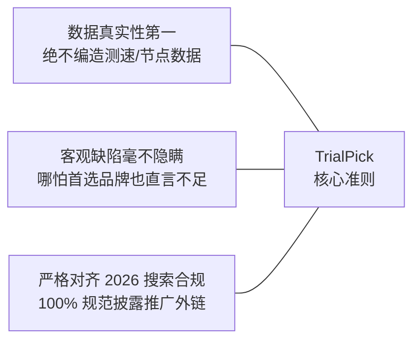

# 关于 TrialPick 评测实验室

<AffDisclaimer position="top" />

> **站点域名**：[trialpick.blog](https://trialpick.blog) ｜ **使命理念**：先试再买，不花冤枉钱 ｜ **更新维护**：TrialPick 实验室团队

---

## 一、我们的创立初衷与使命

欢迎访问 **TrialPick**（[trialpick.blog](https://trialpick.blog)）。我们是一家专注于跨境网络加速、企业级专线与代理服务评测的独立第三方技术实验室。

在过去的几年中，中文代理网络生态经历了大浪淘沙，但信息不对称问题依然极其严重：
- 大量劣质公网机房冒充“企业物理专线”进行虚假宣传；
- 黑产通过“低价年付”或“永久免流”诱导大额充值，随后迅速失联跑路；
- 海量商业导流站点充斥着未经测试的 AI 虚假内容，掩盖节点丢包与严重卡顿。

**TrialPick 正是在这样的背景下创立的。** 我们的唯一核心使命是：**通过真实的网络拨测、严苛的晚高峰压力检验与透明的资费成本分析，帮助用户破除营销迷雾，坚持“先试再买，不花冤枉钱”！** 您可以查阅我们的[2026年10月便宜机场完整实测版排行榜](/rankings/trial-cheap-2026-10)了解最新测评成果。

---

## 二、我们坚守的三大核心原则

1. **真实数据第一原则**：
   - 我们的测试数据全部基于电信千兆、联通千兆与移动 500M 物理宽带真实测算；
   - 绝不编造虚假测速截图、虚构节点数量或伪造用户评价。没有确切官方资料的数据统一标注为“待核实”，详细机房标准见[实验室评测方法论与指标体系](/about/methodology)；
2. **客观中立与缺点直言**：
   - 世界上没有 100% 完美的服务。即使是在我们总榜位列第一的优质专线（如[光速云](/reviews/gsy)），我们也会在评测中明确指出其“入门需年付结算”的局限性；
   - 赞助佣金绝不能买通我们的打分标准，详见[商业推广利益关联与中立性披露](/about/disclosure)；
3. **严格遵守 2026 年搜索引擎合规标准**：
   - 响应 Google 与 Bing 最新发布的联盟营销（Affiliate）与 YMYL 规范；
   - 全站所有商业推广外链必须明确标注 `rel="nofollow sponsored noopener"`，并设置显著的页面双重提示。

---

## 三、关于我们的团队与专栏导航

TrialPick 由具备多年数据中心运维与网络协议分析背景的技术工程师实名维护：

- **[专家作者团队介绍](/about/authors)**：深入了解林晓峰与陈宇的工程师资历与作品档案；
- **[评测方法论与测试标准](/about/methodology)**：查看三大运营商机房测试拓扑与指标计算公式；
- **[商业赞助与利益披露](/about/disclosure)**：透明展示本站的运营资金来源与联盟链接规范；
- **[隐私政策声明](/about/privacy)** 与 **[服务条款协议](/about/terms)**：明确法律合规与用户权益边界。

若想了解具体的选购与避坑方法，欢迎前往[选购指南专栏](/guide/)与[免费试用专栏](/trial/)。

---

## 四、我们不做什么？（合规红线）

- ❌ **我们绝不提供、分发或倒卖任何非法代理节点、翻墙订阅文件或共享账号**；
- ❌ **我们绝不承诺“100% 不过期”、“绝对不会被封”、“永久免流”等欺诈性话术**；
- ❌ **我们绝不冒充任何服务商的官方代理，本站仅为独立第三方媒体**。

---

## 五、联系我们与反馈渠道

如果您在阅读评测时发现某家服务商的资费已发生变动，或者希望向实验室提供最新的网络节点测试样本，欢迎通过以下官方渠道与我们的工程师团队取得联系：

- **官方网站**：`https://trialpick.blog`
- **编辑部技术支持邮箱**：`contact@trialpick.blog`
- **实验室物理测试地址**：上海市浦东新区张江高科技园区网络工程测试节点

---

<AuthorCard authorId="linxiaofeng" lastUpdated="2026-10-01" />

<AffDisclaimer position="bottom" />
