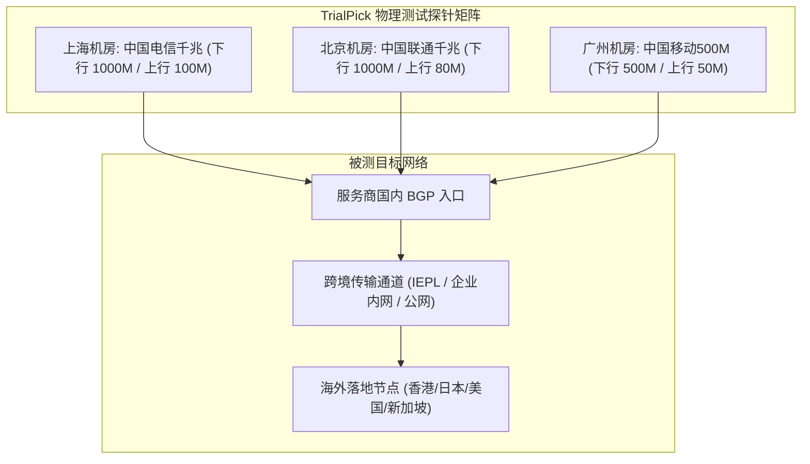
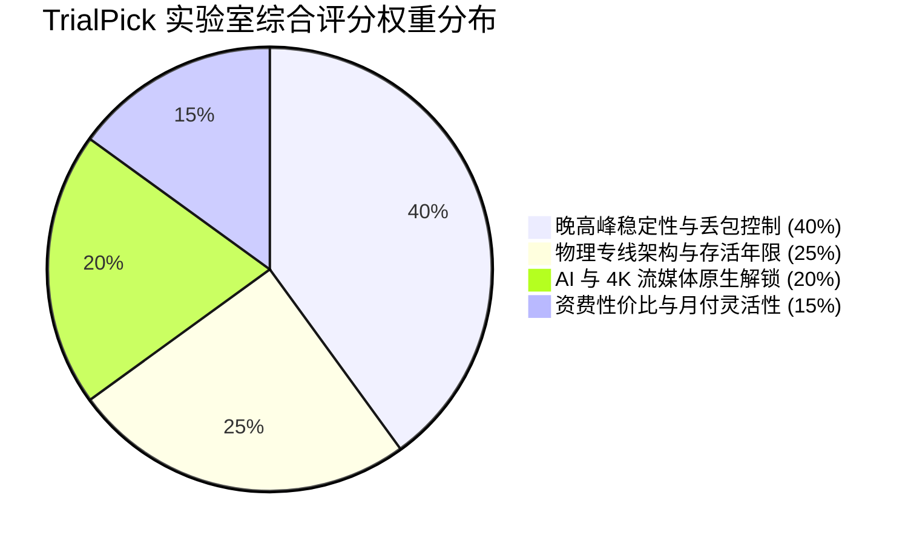

# TrialPick 评测方法论：测试环境、指标体系与打分规则

<AffDisclaimer position="top" />

> **评测站点**：[trialpick.blog](https://trialpick.blog) ｜ **所属专栏**：E-E-A-T 方法论公开 ｜ **作者**：林晓峰（首席测试工程师）

---

## 导读：透明可复现的技术方法论

作为恪守 Google & Bing 2026 年最新 E-E-A-T 准则的技术评测媒体，**TrialPick**（[trialpick.blog](https://trialpick.blog)）坚信：**唯有评测环境透明、测试指标标准化、打分模型可复现，评测数据才具备真正的参考价值**。

本文档完整公开 TrialPick 评测实验室的物理硬件环境、抓包分析工具链与打分权重细则。

---

## 一、物理测试环境基准拓扑

为了消除单一家用网络造成的偶然性偏差，实验室部署了覆盖中国大陆三大主力运营商的真实物理测试探针节点：

- **测试时段划分**：
  - *非高峰基准测试*：每日 10:00 - 16:00（用于获取链路理论最优延迟与极限吞吐）；
  - *晚高峰极限压测*：每日 20:00 - 23:00（重点评估骨干网拥塞时的丢包与抖动）。

---

## 二、测试工具链与指标采集标准

实验室严禁使用任何未经校准的商业测速插件，所有核心数据均采用开源权威工具采集：

1. **`MTR / NextTrace`**：
   - 进行连续 200 个数据包的双向路由追踪，检测是否存在伪专线、虚假中转或公网绕路问题；
2. **`curl (TTFB测试)`**：
   - 测量真实端到端 TCP 握手耗时与 HTTP 首包响应时间（Time To First Byte）；
3. **`iPerf3 多线程吞吐压测`**：
   - 建立 8 个并发 TCP 流，连续打流 60 秒，评估专线带宽物理切片的稳定性；
4. **`CheckMedia / NativeIP 检测脚本`**：
   - 针对 Netflix 原生剧集、Disney+、YouTube Premium 进行地区及住宅 IP 属性核验；
5. **`OpenAI & Claude API 自动化脚本`**：
   - 模拟高频次流式文本交互，记录 Cloudflare 403 阻断率与握手重置率。

---

## 三、四大核心评价支柱与综合评分模型

TrialPick 的最终综合评分（百分制，满分 10.0 分）由以下四个核心维度加权得出：

### 1. 晚高峰稳定性与丢包控制（权重 40%）
- **核心判定**：晚高峰（20:00 - 23:00）连续 200 包测试丢包率低于 0.5% 计满分；丢包率超过 5% 直接扣除该项 50% 分值。

### 2. 物理专线架构与存活年限（权重 25%）
- **核心判定**：开业超过 4 年且采用纯正企业内网/IEPL 物理隔离通道计满分；开业不满 1 年的次新服务上限仅得及格分（防跑路风控考量）。

### 3. AI 与流媒体原生解锁能力（权重 20%）
- **核心判定**：全节点通过 ChatGPT/Claude 深度防风控测试，Netflix 原生内容无限制播放。

### 4. 资费性价比与月付灵活性（权重 15%）
- **核心判定**：单月试错成本低（低于 10 元），或年付折算月费极具竞争力。

---

## 四、数据状态标识规范（Data Status Taxonomy）

为了确保读者对所有数据来源一目了然，本站所有数据字段严格标注以下四类元属性：

- `vendor`：**服务商官方核验数据**（如套餐原价、官方公布流量配额、官方优惠码）；
- `measured`：**实验室真实物理测量数据**（如真实测速下行值、晚高峰丢包率、TCP握手耗时）；
- `editorial`：**编辑部专业分析**（如优缺点提炼、目标人群画像、风险预警评级）；
- `commercial`：**商业赞助合规说明**（标明涉及佣金分佣的合作推广外链）。

---

<ConversionBanner customTitle="严格依据专业方法论评选的总榜冠军【光速云】" />

<AuthorCard authorId="linxiaofeng" lastUpdated="2026-10-01" />

<AffDisclaimer position="bottom" />
