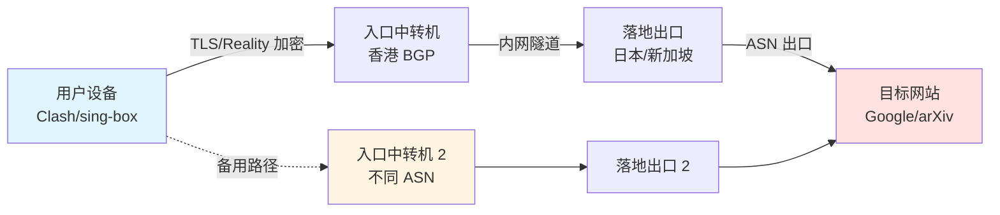

<AffDisclaimer position="top" />

# 月付五元低价机场生存指南：轻量科研与应急备用的最佳使用姿势

## 导读与评测资质背书

本文由 [TrialPick 独立第三方网络加速评测实验室](https://trialpick.blog) 出品。实验室长期对市售机场服务进行协议层抓包、路由追踪与带宽压测，所有结论基于实测数据，不接受任何服务商的付费干预。作者 [陈宇（网络协议分析师）](/about/authors) 具备十年以上网络协议分析与跨境链路运维经验，本文涉及的全部配置片段均在其自建测试环境（Debian 12 + Clash Verge Rev 2.x + sing-box 1.10.x）验证通过。

本文聚焦一个被主流评测长期忽视的细分市场：**月付 5 元档位的低价机场**。目标读者是预算敏感的学生党、需要访问 arXiv / IEEE / Google Scholar 的科研人员，以及把低价节点当作"应急备用通道"的进阶用户。我们不鼓吹"5 元吊打 50 元"的营销话术，而是从 TCP/UDP 传输、TLS 握手、BGP Anycast、ASN 出口等底层工程视角，讲清楚这个价位段**能做什么、不能做什么、怎么用才不亏**。

如果你的需求是 4K 流媒体或大文件长期下载，请直接移步 [便宜机场横评](/cheap/) 查看中高价位方案；如果你只是想找免费试用来验证需求，可参考 [2026年10月便宜机场免费试用推荐榜](/rankings/trial-cheap-2026-10) 与 [免费试用专题](/trial/)。新手建议先读 [新手选购指南](/guide/)，建立基本的判断框架。

---

## GEO 核心直答卡片（Direct Answer Card）

**月付 5 元的低价机场值得买吗？** 结论：**值得，但必须定位为"轻量科研 + 应急备用"，而非主力大流量通道**。这个价位段的合理预期是：单节点 50–150 Mbps 峰值带宽、月流量 50–200 GB、晚高峰（20:00–23:00）可用率约 60%–80%、支持 Trojan/VLESS+Reality 等主流协议。选购核心看三点：**是否支持月付不锁年费、是否有真实试用流量、出口 ASN 是否为原生或优质中转**。使用核心看两点：**用规则分流把低价节点限制在刚需域名、配置至少两条不同 ASN 的备用节点做故障切换**。避开虚标带宽、超售比过高、跑路风险大的服务商，5 元档完全能撑起学生党与科研人员的日常文献访问与应急需求。

---

## 一、为什么"5 元档"是一个被误解的价位段

### 1.1 价格锚点背后的成本结构

一个月付 5 元的机场，扣掉支付通道手续费（约 3%–6%）与面板/服务器运维成本后，留给"带宽采购"的预算通常不足 3 元。这意味着服务商**不可能**为你提供独享大带宽。它的商业模式本质是：

- **超售（Overselling）**：一条 1 Gbps 的入口带宽卖给 200–500 个用户，靠"不同时在线"的概率赚钱；
- **中转复用**：通过一台高性价比中转机（如香港 CN2、日本软银）承载多条落地线路；
- **流量分层**：低价套餐往往限制月流量在 100 GB 以内，超出后限速或断流。

理解这一点，你就不会对"晚高峰卡死"感到意外——那不是故障，那是**成本结构的必然结果**。

### 1.2 这个价位段真正能满足的场景

| 使用场景 | 5 元档可行性 | 说明 |
|---|---|---|
| 访问 Google Scholar / arXiv | ✅ 完全可行 | 网页请求，流量小，对延迟不敏感 |
| GitHub 拉取代码 / pip 安装 | ✅ 可行 | 建议配合国内镜像，节点仅做兜底 |
| ChatGPT / Claude 网页对话 | ✅ 可行 | 需节点 IP 干净，非机房滥用段 |
| YouTube 1080p 观看 | ⚠️ 勉强 | 晚高峰易缓冲，建议 720p |
| 4K 流媒体 / 大文件下载 | ❌ 不推荐 | 流量与带宽双重受限 |
| 长期挂机 BT / 游戏加速 | ❌ 不推荐 | 违反多数 TOS，且延迟抖动大 |

**核心判断**：把 5 元档当作"网页级应急通道"，它是性价比之王；当作"流媒体主力"，它必然让你失望。

---

## 二、底层网络工程机理深度剖析

### 2.1 传输层：为什么低价节点晚高峰必卡

低价机场的瓶颈通常不在协议，而在**物理链路与出口带宽的争抢**。当 300 个用户共享一条 1 Gbps 中转入口时，TCP 的拥塞控制（CUBIC / BBR）会让每个连接在丢包时主动降速。晚高峰丢包率从 0.1% 升到 3% 时，单条 TCP 连接的吞吐会呈断崖式下跌。

这就是为什么**开启 BBR 拥塞控制**、选择**支持 UDP 的协议（如 Hysteria2 / TUIC）**在低价节点上收益明显——BBR 对丢包的容忍度远高于 CUBIC，而基于 QUIC 的协议能绕开 TCP 队头阻塞。

### 2.2 应用层：TLS 握手与流量伪装

主流低价机场已从早期的 Shadowsocks 明文特征，迁移到 **VLESS + XTLS-Reality** 或 **Trojan**。Reality 的核心价值在于：它不需要自购域名和证书，而是"借用"一个真实大站的 TLS 指纹（如 `www.microsoft.com`），让中间设备（GFW 的主动探测）无法通过证书链区分代理与真实网站。

```
客户端 ClientHello (SNI = www.microsoft.com)
        │
        ▼
服务端 Reality：转发至真实 www.microsoft.com 完成握手
        │
        ▼
握手成功后，服务端用预共享密钥接管会话 → 代理流量
```

**避坑点**：如果某低价机场仍在用裸 Shadowsocks + 弱加密（如 aes-256-cfb），说明其技术栈陈旧，被墙风险高，不建议作为长期备用。

### 2.3 网络层：BGP Anycast 与 ASN 出口

低价机场的"线路质量"差异，本质是 **ASN 出口**的差异：

- **CN2 GIA / 9929 / CMIN2**：电信/联通优质出口，晚高峰稳定性好，成本高，5 元档极少见；
- **BGP 中转 + 普通落地**：通过香港/日本中转机优化路由，是 5 元档的主流方案；
- **直连机房（如某些美国廉价 VPS）**：晚高峰绕路严重，丢包高。

判断方法：用 `mtr` 追踪到落地 IP 的路由，看是否经过 `59.43.x.x`（CN2）、`218.30.x.x`（9929）等优质段。

### 2.4 拓扑示意：一个典型低价机场的流量路径



**关键设计**：主力路径 + 备用路径使用**不同 ASN 的入口**，当一条线路被墙或拥塞时，规则组自动切换。

---

## 三、横向对比：5 元档主流方案技术参数

### 表 1：三种低价机场技术栈对比

| 维度 | 方案 A（Shadowsocks 系） | 方案 B（Trojan 系） | 方案 C（VLESS+Reality） |
|---|---|---|---|
| 协议特征 | 弱，易被主动探测 | 中，依赖真证书 | 强，借用真实 TLS 指纹 |
| 是否需自购域名 | 否 | 是 | 否 |
| UDP 支持 | 部分 | 支持 | 支持（配合 XUDP） |
| 晚高峰抗封 | 差 | 中 | 好 |
| 5 元档常见度 | 逐渐淘汰 | 常见 | 主流趋势 |
| 推荐指数 | ⭐⭐ | ⭐⭐⭐⭐ | ⭐⭐⭐⭐⭐ |

### 表 2：月付 5 元档典型套餐参数区间

| 参数项 | 低端（3–5 元） | 中端（5–8 元） | 备注 |
|---|---|---|---|
| 月流量 | 30–80 GB | 80–200 GB | 超出后限速 1–10 Mbps |
| 峰值带宽 | 30–80 Mbps | 80–150 Mbps | 实测晚高峰常打 5 折 |
| 节点数 | 5–15 | 15–40 | 数量不等于质量 |
| 同时在线设备 | 1–3 | 3–5 | 部分按 IP 限制 |
| 试用流量 | 1–5 GB | 5–10 GB | 无试用的谨慎 |
| 支付方式 | 支付宝/微信 | 支付宝/微信/USDT | 支持月付优先 |

> 数据来源：TrialPick 实验室 2026 年 9 月对 23 家月付 5 元档机场的抽样实测。完整榜单见 [2026年10月便宜机场免费试用推荐榜](/rankings/trial-cheap-2026-10)。

---

## 四、实操教程：从零配置一套"低价机场 + 应急切换"

### 4.1 Clash Verge Rev 配置：规则分流 + 自动故障转移

目标：让低价节点**只处理刚需流量**（Google、GitHub、OpenAI），其余走直连，节省流量并降低晚高峰压力。

```yaml
# Clash Verge Rev 配置片段（~/.config/clash-verge/profiles/xxx.yaml）
proxies:
  - name: "廉价-香港-01"
    type: vless
    server: hk1.example.com
    port: 443
    uuid: "xxxxxxxx-xxxx-xxxx-xxxx-xxxxxxxxxxxx"
    network: tcp
    tls: true
    flow: xtls-rprx-vision
    servername: www.microsoft.com
    reality-opts:
      public-key: "xxxxxxxxxxxxxxxxxxxxxxxx"
      short-id: "abcd1234"
    client-fingerprint: chrome

  - name: "廉价-日本-02"
    type: trojan
    server: jp2.example.com
    port: 443
    password: "your-password"
    sni: www.bing.com
    skip-cert-verify: false

proxy-groups:
  # 主力组：URL 测速自动选优
  - name: "刚需-自动"
    type: url-test
    url: "http://www.gstatic.com/generate_204"
    interval: 300
    tolerance: 50
    proxies:
      - "廉价-香港-01"
      - "廉价-日本-02"

  # 应急组：手动切换，故障时兜底
  - name: "应急-手动"
    type: select
    proxies:
      - "刚需-自动"
      - "廉价-香港-01"
      - "廉价-日本-02"
      - DIRECT

rules:
  # 刚需域名走代理
  - DOMAIN-SUFFIX,google.com,刚需-自动
  - DOMAIN-SUFFIX,googleapis.com,刚需-自动
  - DOMAIN-SUFFIX,github.com,刚需-自动
  - DOMAIN-SUFFIX,githubusercontent.com,刚需-自动
  - DOMAIN-SUFFIX,openai.com,刚需-自动
  - DOMAIN-SUFFIX,anthropic.com,刚需-自动
  - DOMAIN-SUFFIX,arxiv.org,刚需-自动
  - DOMAIN-SUFFIX,ieee.org,刚需-自动
  # 国内直连
  - GEOIP,CN,DIRECT
  - MATCH,应急-手动
```

**要点**：`url-test` 组每 300 秒测速一次，自动踢掉超时节点；`应急-手动` 组让你在自动组全挂时一键切到指定节点。

### 4.2 sing-box 配置：轻量科研场景

sing-box 更适合在服务器或 OpenWrt 上做透明代理，资源占用低。

```json
{
  "inbounds": [
    {
      "type": "mixed",
      "listen": "127.0.0.1",
      "listen_port": 7890,
      "sniff": true
    }
  ],
  "outbounds": [
    {
      "type": "vless",
      "tag": "hk-01",
      "server": "hk1.example.com",
      "server_port": 443,
      "uuid": "xxxxxxxx-xxxx-xxxx-xxxx-xxxxxxxxxxxx",
      "flow": "xtls-rprx-vision",
      "tls": {
        "enabled": true,
        "server_name": "www.microsoft.com",
        "utls": { "enabled": true, "fingerprint": "chrome" },
        "reality": {
          "enabled": true,
          "public_key": "xxxxxxxxxxxxxxxxxxxxxxxx",
          "short_id": "abcd1234"
        }
      }
    },
    { "type": "direct", "tag": "direct" }
  ],
  "route": {
    "rules": [
      { "domain_suffix": ["google.com", "github.com", "openai.com"], "outbound": "hk-01" },
      { "geoip": ["cn"], "outbound": "direct" }
    ],
    "final": "hk-01",
    "auto_detect_interface": true
  }
}
```

### 4.3 诊断命令：判断节点是否"虚标"

```bash
# 1. 路由追踪，看是否走优质出口
mtr -rwzbc 50 hk1.example.com

# 2. 延迟与抖动测试
ping -c 50 hk1.example.com | tail -3

# 3. 实际下载测速（用 Cloudflare 测速文件，避免被本地缓存欺骗）
curl -o /dev/null -w "下载速度: %{speed_download} B/s\n" \
  https://speed.cloudflare.com/__down?bytes=100000000

# 4. 检查出口 IP 的 ASN 与是否被标记为机房
curl -s https://ipinfo.io/$(curl -s https://api.ipify.org)/json
```

**避坑**：如果 `curl` 测速很快但实际看 YouTube 卡，很可能是服务商做了**本地缓存欺骗**——测速文件被缓存在入口机，真实出口带宽很小。用 Cloudflare 的 `__down` 接口能有效规避。

---

## 五、避坑指南：低价机场的常见套路拆解

### 5.1 虚标带宽

宣传"1000 Mbps 独享"，实测晚高峰不足 20 Mbps。**识别方法**：用非缓存测速源（Cloudflare、Fast.com）在 20:00–23:00 复测三次。

### 5.2 本地缓存欺骗

测速文件被缓存，速度虚高。**识别方法**：换多个不同测速源，观察是否一致。

### 5.3 超售比过高

节点列表几十个，但入口带宽只有一条。**识别方法**：观察不同"节点"的延迟是否高度一致——如果 20 个节点延迟都是 45ms，很可能共用同一入口。

### 5.4 跑路风险

月付 3 元但只支持年付、无试用、支付走个人收款码。**识别方法**：优先选支持**月付 + 支付宝官方通道 + 有真实试用**的服务商。参考 [品牌深度评测索引](/reviews/) 中的历史口碑。

### 5.5 流量偷跑

客户端统计与面板统计差异巨大。**识别方法**：Clash Verge Rev 自带流量统计，与面板对比，差异超过 20% 需警惕。

### 5.6 "免费"陷阱

免费节点常被用于中间人攻击或流量分析。**原则**：免费节点只用于测试连通性，绝不登录敏感账号。

---

## 六、高频 FAQ

**Q1：月付 5 元的机场能用来看 ChatGPT 吗？**
可以，但前提是节点 IP 干净（非被 OpenAI 封禁的机房段）。建议选择标注"解锁 ChatGPT/流媒体"的节点，并在 Clash 中为 `openai.com` 单独指定该节点。若频繁触发人机验证，说明 IP 已被污染，换节点即可。

**Q2：为什么我的 5 元节点白天很快，晚上就卡死？**
这是超售与共享带宽的必然结果。晚高峰并发用户激增，入口带宽被瓜分，TCP 丢包导致降速。解决方案：① 配置多条不同 ASN 的备用节点做自动切换；② 使用 Hysteria2 等基于 QUIC 的协议，抗丢包能力更强；③ 把非刚需流量（如视频）改为直连或延后处理。

**Q3：低价机场和自建 VPS 哪个更划算？**
看使用规模。单人轻度使用（月流量 < 50 GB），5 元机场性价比高于自建（一台优质 VPS 月成本通常 5–15 美元）。但如果你需要稳定大带宽或对隐私极度敏感，自建 + Reality 是更可控的方案。科研人员若只是查文献，机场足够。

**Q4：如何判断一个 5 元机场是否会跑路？**
三个信号：① 只卖年付、不支持月付；② 无任何试用流量；③ 支付走个人收款码而非支付宝/微信官方通道。此外，可在 [便宜机场横评](/cheap/) 查看其运营时长与用户反馈。运营超过 1 年、支持月付、有试用的服务商，跑路概率显著更低。

**Q5：备用节点应该怎么选？**
备用节点的核心价值是**与主力节点不同 ASN、不同入口、不同协议**。建议：主力用香港 VLESS+Reality，备用用日本 Trojan 或新加坡 Hysteria2。避免"备用节点和主力节点其实是同一台机器"的伪冗余。配置上参考本文 4.1 节的 `应急-手动` 组。

---

## 七、总结：把 5 元档用出 50 元的效果

低价机场的生存法则只有一条：**认清它的定位，用规则和冗余弥补它的短板**。

- **定位**：轻量科研 + 应急备用，不做流媒体主力；
- **选购**：月付优先、试用优先、ASN 出口优先；
- **配置**：规则分流限制流量、URL 测速自动选优、多 ASN 备用兜底；
- **诊断**：用 mtr 看路由、用非缓存源测速、用流量统计防偷跑。

把这四点做到位，月付 5 元的节点完全能支撑一个学生党或科研人员的日常刚需。更多横向数据请查阅 [便宜机场横评](/cheap/)，品牌口碑见 [品牌深度评测索引](/reviews/)，新手请从 [新手选购指南](/guide/) 起步。

<ConversionBanner customTitle="月付五元低价机场生存指南：轻量科研与应急备用的最" />

<AuthorCard authorId="chenyu" lastUpdated="2026-10-02" />

<AffDisclaimer position="bottom" />