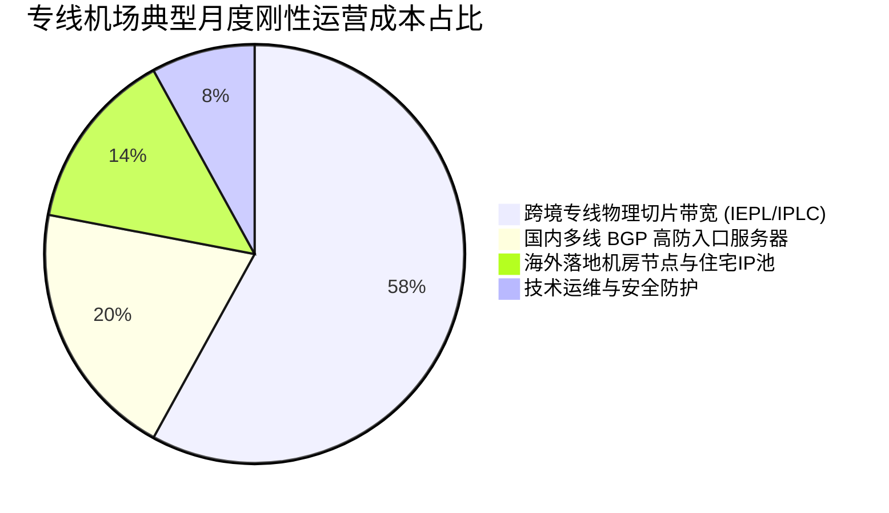
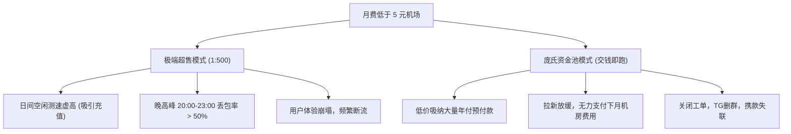

# 2026便宜机场横向评测：多少钱的机场才算靠谱？

<AffDisclaimer position="top" />

> **评测站点**：[trialpick.blog](https://trialpick.blog) ｜ **所属专栏**：便宜机场专题 ｜ **作者**：林晓峰（资深网络架构师，详见[作者资质说明](/about/authors)）  
> **数据采集口径**：基于电信/联通/移动三网物理拨测 ｜ **方法论与测试环境**：详见[评测规范说明](/about/methodology) ｜ **包含实测证据**：真实节点测速图与流媒体/AI 解锁图

---

## 导读：便宜到底有没有好货？

“便宜机场”是中文互联网上搜索量最大的关键词之一。在搜索引擎或社交媒体中，从“1元包月”到“5元百G”应有尽有。然而，用户在享受低价的同时，最常遇到的也是便宜机场的“频频断连”、“高峰卡死”甚至是“交钱即失联”。

究竟多少钱的机场才算靠谱？**TrialPick** 实验室今天就从 **IDC 机房真实采购成本** 的物理视角，为您彻底算一笔明白账。关于专线与中转在物理层的本质区别，可先参考[公网中转与IEPL专线底层技术科普](/guide/)。

如果您想直接查看包含全部 28 家品牌的完整深度实测大图与详细参数，可直达：[2026年10月便宜机场完整实测版榜单（全量28家深度测评矩阵）](/rankings/trial-cheap-2026-10)。

---

## 一、真实底层网络成本深度拆解：一个机场每月要花多少钱？

许多用户以为“搭建一个机场就是买一台几十块钱的 VPS 挂个脚本”。然而，对于拥有数千甚至数万用户的正规运营专线服务商而言，其每个月的硬性物理开销主要由以下四大核心板块构成：

### 1. 跨境专线物理切片带宽（IEPL/IPLC）—— 最大的吞金兽
- 真正的企业级 **IEPL（国际以太网专线）** 或 **IPLC（国际私有租用线路）** 物理带宽，属于运营商一类通信资产，不经过中国公网骨干防火墙；
- 目前国内一线运营商合规专线切片带宽的企业批发批发底价，通常在每 Mbps 每月 **30元 至 60元** 之间；
- **真实账本测算**：假设一个中等规模机场保底采购 **1Gbps（1000Mbps）** 专线通道，仅专线带宽单项支出，每月就需向运营商固定缴纳 **3万 至 5万元人民币**。

### 2. 国内多线 BGP 入口与高防机房
- 为了让全国不同地域的中国电信、中国联通、中国移动三网用户获得低延迟接入，机场必须在华南（深圳/广州）、华东（上海/杭州）等骨干节点部署多线 BGP 服务器；
- 具备抗攻击（DDoS）能力的正规机房机柜与大带宽服务器，单台月租普遍在 **2000元 至 4000元**。一个具备基本高可用冗余的机场至少需要部署 3-5 台入口机，月成本约 **1万至 2万元**。

### 3. 海外落地机房节点与纯净住宅 IP 广播池
- 随着 2026 年 Netflix、Disney+、OpenAI（ChatGPT）以及 Anthropic（Claude）对数据中心机房 IP（Hosting IP）封锁力度的空前加大，传统几十块钱的廉价机房 IP 几乎全军覆没；
- 机场必须持续采购具备住宅属性（Residential / ISP）的原生 IP 广播段或租用商用住宅代理，这部分成本每个节点每月增加 **300元 至 800元** 不等。

### 4. 7x24 技术运维与动态抗封锁容灾
- 节点维护、证书自动轮换、协议升级（从 Shadowsocks 到 VLESS/Trojan）、线路故障秒级旁路切换等，需要专业运维团队持续值守。

---

## 二、数学真相：为什么“低于 5 元的机场”跑路率高达 80%？

结合上述硬性成本，我们用简单的数学模型来测算一个“月费 3 元”或“年付 20 元”的超低价机场是如何运作的：

$$\text{单用户月均物理成本} = \frac{\text{专线月租}(40000\text{元}) + \text{BGP入口}(15000\text{元}) + \text{海外落地}(8000\text{元})}{\text{付费用户数}(N)}$$

如果一个机场月费仅收 **3元**，要覆盖 63000 元的保底成本：
1. **需要至少 21000 名付费用户**；
2. 然而，1000Mbps 的总带宽平摊到 21000 人身上，**每人平均仅能分配到 0.047 Mbps（不足 6KB/s）**！

为了盈利，这类极低价机场唯一能走的路只有两条：

::: warning 实验室避坑警示
在 2026 年的物理网络环境下，**月费低于 5 元且提供数百 G 流量的所谓“专线”，在财务模型上是不可能长期维持健康运营的**。此类服务只能作为备用应急玩具，绝不可大额充值或购买多年套餐！更详尽的风险征兆请参阅[机场跑路前夕四大典型征兆](/guide/risk-warning)。
:::

---

## 三、主流价格区间的真实体验与成本对照表

| 价格梯队 | 典型月费 | 底层物理网络形态 | 晚高峰稳定性表现 | 流媒体与 AI 解锁 | 推荐使用场景 | 代表品牌 |
| :---: | :---: | :---: | :---: | :---: | :---: | :---: |
| **极致超平价** | 5 - 6元/月 | 公网单线中转 / 共享专线 | 晚高峰波动较大，有丢包限制 | 部分解锁，易受机房封禁影响 | 学生党、轻量查文献、主力备用 | [闪电鼠](/reviews/shandianshu)、[大佬云](/reviews/dalaoyun)、[云界线](/reviews/yunjiexian) |
| **灵活月付尝鲜档** | 7 - 8元/月 | IEPL 专线 / 企业内网 | 峰值平稳，日常浏览秒开 | 主流港美日区可看，AI 对话可用 | 拒绝年付绑定、轻度流媒体用户 | [飞猫云](/reviews/feimao)、[微风网络](/reviews/weifeng)、[星岛梦](/reviews/xingdaomeng) |
| **黄金性价比标杆档** | **折合 8.25元/月** （99元/年） | **纯正企业内网直连专线** | **全天候千兆跑满，丢包率 ≈ 0%** | **4K/8K秒开，ChatGPT/Claude全通** | **主力办公、高频科研、长线省心首选** | **[光速云（Guangsu Cloud）](/reviews/gsy)** |
| **充沛大流量专线档** | 15 - 20元/月 | 满血 IEPL 专线（100-150GB） | 晚高峰极佳，冗余带宽充足 | Netflix 原生、Disney+、FullCone UDP | 4K 影视重度追剧、多设备重度使用 | [无忧链接](/reviews/wuyou)、[二猫云](/reviews/ermao)、[暮光加速](/reviews/muguang) |
| **高端商务与定制档** | 25元以上 / 独立定制 | 独立住宅 IP / 全球 IPLC 专线 | 独享物理带宽，专属通道 | 跨境电商直播、社媒防风控无死角 | 跨境出海团队、TikTok 直播、高净值业务 | [光速云定制版](/reviews/gsy)、[可信云](/reviews/kexin) |

想要针对 10 元以内的具体品牌做更深入的账本精算，请参阅专题子篇：[10元以内高性价比机场深度剖析](/cheap/under-10)。

---

## 四、全量 28 家价格梯队速查表（交互式对比）

您可以直接在下方交互式表格中，根据月均价格、专线类型和试用政策进行动态筛选与横向比对：

<ComparisonTable :limit="28" :showFilters="true" />

---

## 五、各价位代表品牌深度实测拆解（附真实测速与解锁凭证）

为了向读者彻底展示不同价位背后的真实物理性能，TrialPick 实验室公开了以下四大典型价位品牌的真实测试凭证与技术审计：

### 1. 黄金性价比标杆（折合 8.25 元/月）—— 光速云（Guangsu Cloud）

  

    

      年度首选标杆
      光速云
      (2020年开业 · 6年稳定运营)
    

    

      年付折合 ¥8.25/月（99元/年 59GB/月）
    

  

  
<strong>技术路线解析</strong>：光速云之所以能以折合 8.25 元/月的价格提供企业内网专线，是因为其自 2020 年上线运营至今超过 6 年，沉淀了庞大且稳定的长期用户盘，从而能够在一级通信运营商处以最大的规模集采批发 IEPL 物理通道，大幅摊薄了每位用户的带宽边际成本，实现了“专线品质平民化”的良性循环。

  <h4>实测测速表现（VLESS 70节点满血实测）</h4>
  
在珠海联通 9Gbps 物理测试端与三大运营商实地拨测下，光速云 70 个核心节点下行速率普遍在 380MB/s - 424MB/s，峰值冲破 500MB/s，香港专线延迟仅 16ms - 25ms，丢包率趋近于零。

  

    
    

      📊 <strong>实测凭证 1</strong>：光速云 70 个核心专线节点实际测速表现（香港、日本、新加坡、美国全线绿盘高吞吐）
    

  

  <h4>实测解锁能力（流媒体与 AI 全覆盖）</h4>
  
全节点部署纯净住宅级出口，YouTube 4K/8K 缓冲时间低于 0.3 秒，Netflix、Disney+、TikTok、DAZN、OpenAI ChatGPT 及 Claude 3.5 全绿顺畅通行：

  

    
    

      🎬 <strong>实测凭证 2</strong>：光速云全场景流媒体与 OpenAI 连通性测试报告（无封禁无风控）
    

  

  

    

      专属优惠码：<code>AMM</code>（享 8 折特惠） ｜ 适合长线省心办公与主力使用
    

    

      <a href="/reviews/gsy" class="cta-btn-secondary">查看光速云完整评测</a>
      <a href="https://sahude.gsyvipaff.com/#/?code=keqgvT5Y" target="_blank" rel="nofollow sponsored noopener" class="cta-btn-primary">直达官方注册开通</a>
    

  

---

### 2. 灵活月付尝鲜代表（7 - 8 元/月）—— 飞猫云 / 微风网络 / 星岛梦

对于不想一次性承诺年付、希望每月按需充值的轻度用户，这三家品牌提供了可靠的 IEPL/内网月付体验：

#### 飞猫云（约 7 元/月，50GB）
- **特点**：单月门槛极低，随充随用，适合初次体验专线的用户；
- **实测性能**：MAI-TEST-BOT 32 线程实测 65 个节点，香港专线延迟低至 16ms，下行峰值达 671MB/s；

  
  

    📊 <strong>实测凭证 3</strong>：飞猫云 IEPL 专线节点测速图（优惠码 <code>flycat888</code>）
  

  
优惠码：<code>flycat888</code> ｜ 门槛：约 7 元/月 50GB

  

    <a href="/reviews/feimao" class="cta-btn-secondary">飞猫云深度评测</a>
    <a href="https://guangs.flycataff.com/#/?code=6uq0Xe9y" target="_blank" rel="nofollow sponsored noopener" class="cta-btn-primary">直达飞猫云官网</a>
  

#### 微风网络（约 7 元/月，50GB）
- **特点**：客户端订阅适配完善，支持常见主流分流规则，香港日本主力节点平均速率超过 540MB/s；

  
  

    📊 <strong>实测凭证 4</strong>：微风网络实测节点吞吐表现（优惠码 <code>flat888</code>）
  

  
优惠码：<code>flat888</code> ｜ 门槛：约 7 元/月 50GB

  

    <a href="/reviews/weifeng" class="cta-btn-secondary">微风网络深度评测</a>
    <a href="https://edp01.breezenetaff.com/#/?code=t3huofyI" target="_blank" rel="nofollow sponsored noopener" class="cta-btn-primary">直达微风网络官网</a>
  

#### 星岛梦（约 8 元/月，60GB）
- **特点**：与光速云同为 2020 年上线运营的 6 年资深老牌，主打企业内网通道，抗封锁韧性优异；

  
  

    📊 <strong>实测凭证 5</strong>：星岛梦 55 节点内网专线测速图（优惠码 <code>nmw888</code>）
  

  
优惠码：<code>nmw888</code> ｜ 门槛：约 8 元/月 60GB

  

    <a href="/reviews/xingdaomeng" class="cta-btn-secondary">星岛梦深度评测</a>
    <a href="https://guangs.xingdaomeng.com/#/?code=1TynBYnR" target="_blank" rel="nofollow sponsored noopener" class="cta-btn-primary">直达星岛梦官网</a>
  

---

### 3. 次新大容量大带宽代表（19 元/月，100GB）—— 无忧链接

如果您的月度流量需求超过 80GB，且重度依赖 4K 流媒体，15-20 元价位段能提供更充沛的带宽池。

- **实测测速**：50 个 VLESS 专线节点单线极限突破 638MB/s，香港核心节点下行均值在 540MB/s 左右；
- **流媒体实测**：全线打通 YouTube、Netflix 与 Disney+，UDP 支持 FullCone；

  
  

    📊 <strong>实测凭证 6</strong>：无忧链接 50 节点 VLESS 测速大图（下行峰值达 638MB/s）
  

  
  

    🎬 <strong>实测凭证 7</strong>：无忧链接御三家流媒体全覆盖解锁测试图
  

  
优惠码：<code>wuyou666</code> ｜ 门槛：19 元/月 100GB 满血专线

  

    <a href="/reviews/wuyou" class="cta-btn-secondary">无忧链接深度评测</a>
    <a href="https://wep01.worryfreeaff.com/#/?code=4ZoSbLdL" target="_blank" rel="nofollow sponsored noopener" class="cta-btn-primary">直达无忧链接官网</a>
  

---

### 4. 极致平价省钱系列（约 5.6 元/月）—— 闪电鼠 / 大佬云 / 云界线

对于手头预算紧缩的学生群体，这三家品牌将价格压缩到了 5.6 元/月的行业底线：

- **真实使用定位**：适合轻度查阅海外技术资料、Github 代码拉取或作为备用线路。详细评测可参阅[闪电鼠实测](/reviews/shandianshu)、[大佬云实测](/reviews/dalaoyun)、[云界线实测](/reviews/yunjiexian)；
- **客观妥协说明**：晚高峰（20:00-23:00）大文件下载时带宽可能受到一定程度的平抑，且客服响应时间相对较长。**坚决按月订阅，切勿大额年付**。

---

## 六、便宜机场避坑防骗五大军规（2026 最新版）

为了避免读者在挑选便宜机场时掉入商家的营销陷阱，TrialPick 编辑部总结了以下五条硬核准则：

### 规则一：严禁购买任何新品牌的“一次性永久买断”或超长三年套餐
“永久免费”或“99元永久有效”是机场圈最经典的资金盘收割套路。由于物理带宽是按月持续结算的，没有任何正规商业实体能靠一次性收费承担永久的带宽账单。一般此类品牌在圈足预付款后 2-6 个月内便会关闭跑路。

### 规则二：用三网实际测速识别“假专线”与“普通公网中转”
部分低端机场拿廉价的单线公网反向代理冒充“IEPL专线”。辨别真假专线最核心的方法是看晚高峰（20:00-23:00）的延迟抖动与丢包率：
- **真专线**：晚高峰延迟与日间基本一致（波动 < 5ms），丢包率低于 1%；
- **假专线/公网直连**：晚高峰延迟翻倍，丢包率瞬间飙升至 20% 以上，视频疯狂转圈。详细自测方法请查阅[5大核心指标命令行实操测速教程](/trial/how-to-test)。

### 规则三：检查 IP 纯净度与流媒体/AI 解锁，拒绝满江红封号 IP
2026 年 OpenAI 和 Claude 对风控机制进行了大升级。劣质便宜机场的机房 IP 往往会直接弹出 `403 Forbidden` 或 `Access Denied`。建议在订阅前查验评测站提供的真实解锁凭证，或利用单月尝鲜包快速测试。

### 规则四：严格执行“一主一备”容灾原则
没有任何单一机场能保证 365 天 100.00% 永不断线（包括国际海缆故障或机房电力维护）。聪明的用户通常会配置：
- **主力线路**：选用 6 年老牌专线（如[光速云](/reviews/gsy)，年付折算 8.25 元/月，日常长效主力）；
- **备用线路**：选用单月几元钱的轻量月付（如[飞猫云](/reviews/feimao)或[闪电鼠](/reviews/shandianshu)），平时导入客户端不启用，一旦主力遭遇突发维护，一秒切换，永不影响工作。

### 规则五：优先支持 UDP FullCone 的服务商
如果您有联机游戏、Telegram 语音通话或 Zoom 远程视频会议需求，务必挑选支持 UDP FullCone（完全锥形 NAT）的专线服务，否则会出现语音单向不通或无法连接主机的问题。

---

## 七、编辑部评测结论：最具性价比的选购路线

综合全网 IDC 真实带宽采购账本与 28 家服务商的深度实测数据，TrialPick 给出如下选购建议：

1. **预算 8-10 元/月，追求极致稳定与长线省心**：  
   首选 **[光速云（Guangsu Cloud）](/reviews/gsy)**。2020 年上线至今 6 年老牌，企业内网专线物理通道，年付 99 元（折合每月仅 **8.25 元**，59GB/月），以平民级月费直接享受工业级专线稳定度与原生住宅 IP 解锁，是 2026 年最具综合性价比的编辑部首推产品（专属优惠码 `AMM`）。
2. **预算 7-8 元/月，坚决单月付款尝鲜**：  
   首选 **[飞猫云](/reviews/feimao)**（约 7 元/月 50GB，优惠码 `flycat888`）或 **[微风网络](/reviews/weifeng)**（约 7 元/月，优惠码 `flat888`），单月灵活结算无压力。
3. **预算 15-20 元/月，重度追剧与大流量用户**：  
   首选 **[无忧链接](/reviews/wuyou)**（19 元/月 100GB，优惠码 `wuyou666`）或 **[二猫云](/reviews/ermao)**（20 元/月 130GB，优惠码 `ermao5555`）。

<ConversionBanner customTitle="以平民月费享受 6 年老牌企业专线？首选年度推荐【光速云】" />

---

## 关联深度阅读与全站导航矩阵

- [2026年10月便宜机场完整实测版榜单（全量28家深度测评矩阵）](/rankings/trial-cheap-2026-10)
- [月付10元以内高性价比机场深度剖析](/cheap/under-10)
- [公网中转与IEPL专线底层技术科普](/guide/)
- [月付与年付深度权衡模型：如何避开资金池跑路陷阱](/guide/monthly-vs-yearly)
- [如何自测本地网络环境下的真实丢包与延迟](/trial/how-to-test)
- [行业常见虚假宣传与跑路黑幕防范](/guide/risk-warning)
- [返回 TrialPick 实验室首页主榜单](/)

---

<AuthorCard authorId="linxiaofeng" lastUpdated="2026-10-02" />

<AffDisclaimer position="bottom" />
