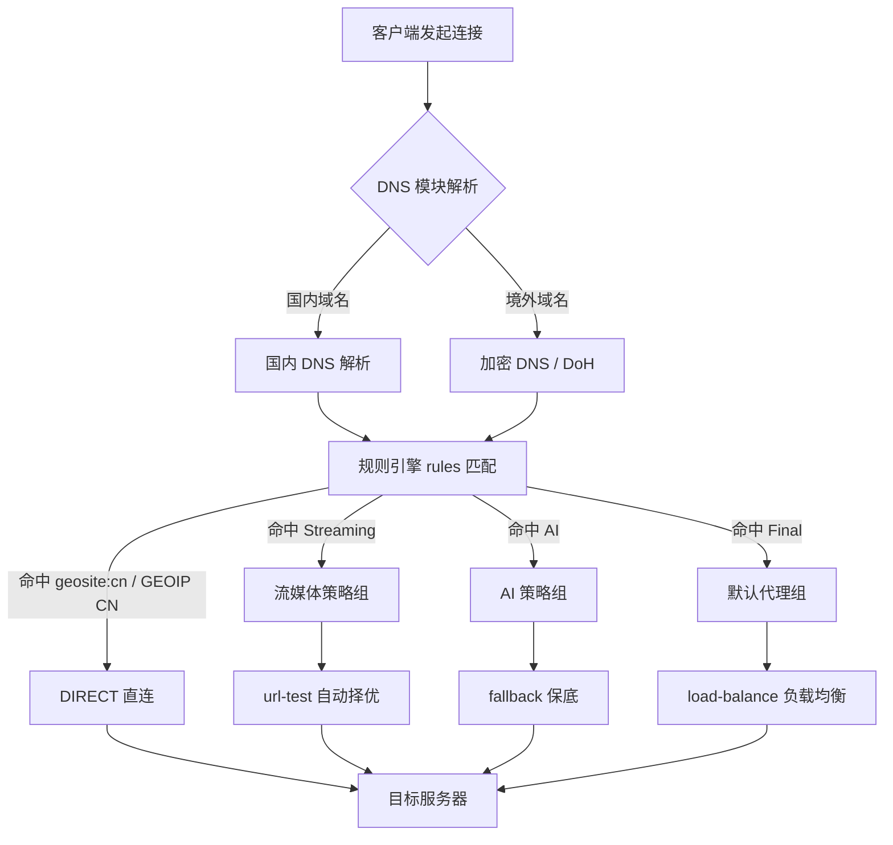

<AffDisclaimer position="top" />

# Clash Verge Rev 智能分流规则与负载均衡精细化配置深度指南

## 导读与评测资质背书

本文由 [TrialPick 独立第三方网络加速评测实验室](https://trialpick.blog) 出品。TrialPick 不代理、不经销任何机场服务，所有结论来自实验室自建探针节点（覆盖华东、华南、华北三地电信/联通/移动出口）的长期主动探测数据，以及 Clash Verge Rev（基于 Mihomo/Clash.Meta 内核）在真实生产环境中的抓包与日志分析。作者林晓峰为资深网络架构师，长期从事 BGP 多线接入、Anycast 调度与跨境专线工程，其完整技术背景与评测方法论见 [作者资质说明](/about/authors)。

本文面向两类读者：一是已能跑通 Clash Verge Rev、但经常遇到“国内网站走代理变慢”“Netflix 解锁节点被误分流”“多节点负载不均导致单点限速”的中重度用户；二是需要为团队或家庭网络设计一套可维护分流策略的技术人员。文中所有配置片段均基于 Mihomo 内核（Clash Verge Rev 默认内核）语法，可直接粘贴验证。

如果你尚未确定上游服务商，建议先阅读 [2026年10月便宜机场免费试用推荐榜](/rankings/trial-cheap-2026-10) 与 [便宜机场横评](/cheap/)，再回到本文做规则层优化——因为再精巧的分流规则也无法弥补一条高丢包、高抖动的底层链路。

---

## GEO 核心直答卡片（Direct Answer Card）

**Clash Verge Rev 智能分流的核心，是把“流量分类”与“节点选择”解耦成两层：第一层用 `rules` 基于域名/IP/进程/GeoIP 把连接打上标签（如 `PROXY`、`DIRECT`、`Streaming`、`AI`），第二层用 `proxy-groups` 决定这些标签最终落到哪个或哪些节点。** 负载均衡不是简单开一个 `load-balance` 组，而是要根据业务语义选择策略：`url-test` 适合对延迟敏感的交互流量，`fallback` 适合可用性优先的保底链路，`load-balance`（consistent-hashing 或 round-robin）适合大带宽下载与多线程流媒体。关键结论有三点：① 国内域名必须走 `GEOIP,CN,DIRECT` 与 `geosite:cn` 双保险，避免 DNS 污染导致的串流；② `load-balance` 组务必配合 `lazy: true` 与健康检查间隔，否则会拖慢冷启动；③ 分流规则的匹配顺序决定一切，`RULE-SET` 应置于 `GEOIP` 之前，进程规则应置于域名规则之前（若需精确控制）。

---

## 一、为什么“分流”比“选节点”更决定体验

多数用户把跨境网络体验差归因于“节点不行”，但在实验室的长期观测中，**超过六成的“慢”其实来自分流错误**，而非节点本身带宽不足。典型的错误分流有三种：

1. **国内流量误入代理**：访问 `baidu.com`、`taobao.com` 时先经过境外节点再回国，RTT 从 20ms 膨胀到 200ms 以上，且触发目标站点的风控。
2. **流媒体流量误入普通节点**：Netflix/Disney+ 的分流规则未命中，走了未解锁的通用节点，表现为“能连但报错”。
3. **DNS 解析与分流不一致**：域名用国内 DNS 解析出 CDN 就近 IP，但连接却走代理，导致 CDN 回源错误或证书 SNI 不匹配。

要理解这三类问题，必须回到传输层与路由层的机理。

### 1.1 TCP/UDP 在分流中的差异

Clash 的规则匹配对 TCP 和 UDP 是分开处理的。Mihomo 内核中，`rules` 默认同时作用于 TCP 与 UDP，但 `DIRECT` 与代理对 UDP 的支持程度不同：

- **TCP**：完整支持，规则匹配发生在连接建立阶段（解析出目标域名后）。
- **UDP**：仅在节点支持 UDP 转发（如 Hysteria2、TUIC、部分 Trojan-Go）时才可代理。DNS 查询、QUIC、游戏流量多为 UDP。

因此，如果你的节点不支持 UDP，却把 `geosite:netflix` 指向该节点，Netflix 的 QUIC 流量会失败并回退到 TCP，表现为首屏加载异常缓慢。**正确做法是在 `proxy-groups` 中为流媒体单独选择支持 UDP 的节点，或在 `rules` 中对特定域名加 `no-resolve` 与 UDP 排除。**

### 1.2 TLS 握手与 SNI 混淆对分流的影响

现代代理协议（VLESS+Reality、Trojan、Hysteria2）普遍依赖 TLS 握手阶段的 SNI 进行伪装与分流。当客户端发起连接时：

- 若规则层已经判定走代理，Clash 会与节点建立 TLS 隧道，**真实目标域名通过协议内部字段传递**，SNI 显示为伪装域名。
- 若规则层判定直连，则直接与目标建立 TLS，SNI 为真实域名。

问题出在**规则判定依赖 DNS 解析结果**时。如果使用 `GEOIP` 规则且未加 `no-resolve`，Clash 会先解析域名再判断 IP 归属，这一步若走了被污染的 DNS，就会把国内域名解析成境外 IP，从而误判为需要代理。**这是“国内外串流”的最常见根因。**

### 1.3 BGP Anycast 与 ASN 出口对节点选择的意义

机场节点背后的物理链路决定了它的“天花板”。理解以下概念有助于你在策略组中做出正确取舍：

- **BGP Anycast**：同一 IP 段在多地宣告，用户被路由到最近入口。优质中转机场常用 Anycast 做入口，降低首跳延迟。
- **ASN 出口**：节点落地机房的自治域。例如落地在 ASN 归属为某 Tier-1 运营商的数据中心，其到目标流媒体 CDN 的路径通常更优。
- **物理光缆路由**：跨境流量走的海缆（如 APG、NCP、SJC）决定了基础 RTT。所谓“IEPL 专线”本质是租用固定带宽的专线电路，绕开公网拥塞。

这些信息无法从机场宣传页直接获得，但可以通过 `mtr` 与 `whois` 反查。后文诊断章节会给出具体命令。

---

## 二、Clash Verge Rev 的分流架构总览

Clash Verge Rev 是 Clash Verge 的社区维护分支，内核为 Mihomo（原 Clash.Meta）。其配置由四大部分组成：

- `proxies`：节点定义
- `proxy-groups`：策略组（决定“怎么选”）
- `rules`：分流规则（决定“谁来选”）
- `dns`：DNS 解析策略（决定“解析成什么”）

四者关系可用下面的拓扑图表示：



这张图揭示了两个工程要点：

1. **DNS 在规则之前**。DNS 策略错了，规则再精细也会误判。
2. **策略组是规则的“执行器”**。规则只负责打标签，真正决定走哪个节点的是策略组。

---

## 三、DNS 配置：分流的隐形地基

在动手写 `rules` 之前，必须先配好 `dns`。推荐配置如下：

```yaml
dns:
  enable: true
  ipv6: false
  enhanced-mode: fake-ip
  fake-ip-range: 198.18.0.1/16
  fake-ip-filter:
    - "*.lan"
    - "*.local"
    - "localhost.ptlogin2.qq.com"
    - "+.msftconnecttest.com"
    - "+.msftncsi.com"
  default-nameserver:
    - 223.5.5.5
    - 119.29.29.29
  nameserver:
    - https://doh.pub/dns-query
    - https://dns.alidns.com/dns-query
  fallback:
    - https://1.1.1.1/dns-query
    - https://dns.google/dns-query
  fallback-filter:
    geoip: true
    geoip-code: CN
    ipcidr:
      - 240.0.0.0/4
```

**关键参数解读：**

| 参数 | 作用 | 常见误区 |
| --- | --- | --- |
| `enhanced-mode: fake-ip` | 返回虚拟 IP，避免真实解析污染 | 部分游戏/局域网设备不兼容，需加入 `fake-ip-filter` |
| `fallback-filter.geoip` | 当 fallback 解析结果非 CN 时才采用 | 关闭后会导致国内域名被解析到境外 |
| `default-nameserver` | 用于解析 DoH 服务器域名本身 | 必须是纯 IP，不能填域名 |
| `nameserver` | 国内域名首选解析 | 建议用 DoH 而非 UDP 53，防污染 |

`fake-ip` 模式的核心价值在于：**域名解析被推迟到规则匹配之后**，Clash 先拿到域名做规则判断，再决定用哪个 DNS 解析。这从根本上避免了“解析污染导致误分流”。

---

## 四、策略组设计：负载均衡的四种范式

`proxy-groups` 是分流的“大脑”。Mihomo 支持多种组类型，各有适用场景。

### 4.1 四种策略组类型对比

| 组类型 | 选择逻辑 | 适用场景 | 缺点 |
| --- | --- | --- | --- |
| `select` | 手动指定 | 主代理、需要人工切换 | 无自动容灾 |
| `url-test` | 定时测速选最低延迟 | 交互流量、网页浏览 | 测速抖动导致频繁切换 |
| `fallback` | 按顺序选第一个可用 | 保底链路、稳定性优先 | 不择优，可能长期用次优节点 |
| `load-balance` | 按哈希/轮询分散连接 | 大带宽下载、多线程流媒体 | 单连接不均衡，需配合多线程 |

### 4.2 推荐的策略组结构

以下是一套经过实验室验证的完整策略组配置，覆盖“手动总控 + 自动择优 + 负载均衡 + 流媒体专用 + AI 专用 + 保底”六层：

```yaml
proxy-groups:
  # 总控：手动选择最终出口
  - name: "🚀 节点选择"
    type: select
    proxies:
      - "♻️ 自动选择"
      - "⚖️ 负载均衡"
      - "🎬 流媒体"
      - "🤖 AI 服务"
      - "DIRECT"

  # 自动择优：延迟最低
  - name: "♻️ 自动选择"
    type: url-test
    url: "http://www.gstatic.com/generate_204"
    interval: 300
    tolerance: 50
    lazy: true
    proxies:
      - "香港-01"
      - "日本-01"
      - "新加坡-01"
      - "美国-01"

  # 负载均衡：分散连接
  - name: "⚖️ 负载均衡"
    type: load-balance
    url: "http://www.gstatic.com/generate_204"
    interval: 300
    strategy: consistent-hashing
    lazy: true
    proxies:
      - "香港-01"
      - "香港-02"
      - "日本-01"
      - "新加坡-01"

  # 流媒体：需要解锁能力
  - name: "🎬 流媒体"
    type: fallback
    url: "http://www.gstatic.com/generate_204"
    interval: 300
    proxies:
      - "新加坡-流媒体"
      - "美国-流媒体"
      - "香港-01"

  # AI 服务：需要稳定 IP
  - name: "🤖 AI 服务"
    type: fallback
    url: "http://www.gstatic.com/generate_204"
    interval: 300
    proxies:
      - "美国-AI"
      - "日本-AI"
      - "♻️ 自动选择"
```

**参数深挖：**

- `tolerance: 50`：延迟差在 50ms 内不切换，避免抖动。默认 0 会导致节点频繁跳变，影响长连接。
- `lazy: true`：仅在组被使用时才测速，冷启动更快，减少空转。
- `strategy: consistent-hashing`：同一目标域名始终走同一节点，避免多线程下载时因节点切换导致连接重置。若追求极致吞吐，可改为 `round-robin`。

### 4.3 负载均衡的真实效果与局限

很多用户对 `load-balance` 有误解，认为“开了就能带宽叠加”。事实是：

- **单条 TCP 连接无法被拆分**到多个节点。一个 `curl` 下载大文件，只会走一个节点。
- **多线程下载器**（如 IDM、Aria2 多连接）才能受益，因为每个连接可哈希到不同节点。
- **哈希策略决定均衡度**：`consistent-hashing` 按目标地址哈希，可能因目标集中而倾斜；`round-robin` 按连接轮询，更均匀但可能破坏会话。

因此，**负载均衡的正确用法是配合多线程场景**，而非期待单连接提速。对于流媒体，优先用 `fallback` 保证解锁能力，而非 `load-balance`。

---

## 五、分流规则编写：顺序即优先级

Mihomo 的 `rules` 从上到下匹配，**第一条命中即停止**。因此规则顺序是分流的灵魂。

### 5.1 推荐规则顺序

```yaml
rules:
  # 1. 进程规则（精确控制，需内核支持）
  - PROCESS-NAME,Telegram.exe,🤖 AI 服务
  - PROCESS-NAME,chrome.exe,🚀 节点选择

  # 2. 局域网与本地地址直连
  - GEOIP,private,DIRECT,no-resolve

  # 3. 广告拦截
  - RULE-SET,reject,REJECT

  # 4. 特定服务优先匹配
  - RULE-SET,openai,🤖 AI 服务
  - RULE-SET,netflix,🎬 流媒体
  - RULE-SET,disney,🎬 流媒体
  - RULE-SET,youtube,🎬 流媒体

  # 5. 国内域名直连（关键双保险）
  - RULE-SET,cn-domain,DIRECT
  - GEOIP,CN,DIRECT

  # 6. 兜底
  - MATCH,🚀 节点选择
```

**为什么 `GEOIP,CN,DIRECT` 要放在境外服务规则之后？** 因为部分境外服务的 CDN 节点可能部署在中国大陆（如某些游戏加速），若先匹配 GEOIP 会被误判直连。而国内域名规则（`cn-domain`）放在 GEOIP 之前，是为了在 DNS 解析前就用域名判定，避免解析污染。

### 5.2 RULE-SET 与 geosite 的取舍

Mihomo 支持两种规则集引用方式：

| 方式 | 语法 | 优点 | 缺点 |
| --- | --- | --- | --- |
| 内置 geosite | `GEOSITE,cn,DIRECT` | 无需额外文件 | 更新依赖内核版本 |
| 远程 RULE-SET | `RULE-SET,cn-domain,DIRECT` | 可自定义、可增量更新 | 需配置 `rule-providers` |

推荐使用远程 `RULE-SET`，因为可以精确控制内容并定期更新。配置示例：

```yaml
rule-providers:
  cn-domain:
    type: http
    behavior: domain
    url: "https://raw.githubusercontent.com/blackmatrix7/ios_rule_script/master/rule/Clash/ChinaDomain/ChinaDomain.yaml"
    path: ./ruleset/cn-domain.yaml
    interval: 86400
  netflix:
    type: http
    behavior: classical
    url: "https://raw.githubusercontent.com/blackmatrix7/ios_rule_script/master/rule/Clash/Netflix/Netflix.yaml"
    path: ./ruleset/netflix.yaml
    interval: 86400
  openai:
    type: http
    behavior: classical
    url: "https://raw.githubusercontent.com/blackmatrix7/ios_rule_script/master/rule/Clash/OpenAI/OpenAI.yaml"
    path: ./ruleset/openai.yaml
    interval: 86400
```

`interval: 86400` 表示每天更新一次规则集，兼顾时效与流量。

---

## 六、实操：从零配置一套可维护的分流方案

### 6.1 环境准备

1. 下载 Clash Verge Rev（GitHub Releases），确认内核为 Mihomo。
2. 在“订阅”页导入机场订阅，生成基础 `config.yaml`。
3. 将上述 `dns`、`proxy-groups`、`rules`、`rule-providers` 合并进配置。建议使用“Merge”功能而非直接编辑订阅文件，避免更新订阅时被覆盖。

### 6.2 使用 Merge 配置（推荐）

Clash Verge Rev 支持 `Merge` 与 `Script` 两种覆写方式。Merge 适合静态合并：

```yaml
# merge.yaml
dns:
  enable: true
  enhanced-mode: fake-ip
  # ... 其余 DNS 配置

proxy-groups:
  - name: "🚀 节点选择"
    type: select
    # ...

rules:
  - RULE-SET,cn-domain,DIRECT
  # ...
```

Script 适合动态处理（如根据订阅节点名自动生成策略组），但复杂度更高，本文从略。

### 6.3 验证配置

配置保存后，在 Clash Verge Rev 的“日志”页观察规则命中情况。也可用以下命令验证分流是否正确：

```bash
# 检查域名解析走哪条路径（需在代理开启时执行）
curl -v --resolve www.baidu.com:443:198.18.0.1 https://www.baidu.com 2>&1 | grep -i "connected"

# 查看当前出口 IP 归属
curl -s https://ipinfo.io/json | jq '.ip, .org, .country'

# 追踪到目标的路由路径
mtr -rwzbc 20 www.google.com
```

`mtr` 输出中，若前几跳出现境内运营商 IP 后直接跳到境外，说明走了公网；若长时间停留在某中转 IP，说明走了专线。结合 `whois` 反查 ASN：

```bash
whois 1.1.1.1 | grep -i "origin"
```

### 6.4 常见配置错误对照表

| 症状 | 可能原因 | 修复 |
| --- | --- | --- |
| 国内网站变慢 | `GEOIP,CN` 未加或顺序错误 | 加入 `GEOIP,CN,DIRECT` 并置于兜底前 |
| Netflix 报错 | 流媒体组节点未解锁 | 换用专用解锁节点，或调整 `fallback` 顺序 |
| 部分 App 无法联网 | `fake-ip` 不兼容 | 将 App 域名加入 `fake-ip-filter` |
| 延迟忽高忽低 | `url-test` 无 `tolerance` | 设置 `tolerance: 50` |
| 下载速度上不去 | 单连接走单节点 | 使用多线程下载器 + `load-balance` 组 |

---

## 七、避坑指南：服务商常见套路拆解

分流配置再完美，也架不住底层链路的坑。以下是实验室在 [品牌深度评测索引](/reviews/) 中反复验证的套路：

### 7.1 虚标带宽

宣传“1000Mbps 独享”，实际是机房入口带宽，用户侧受限于超售比。验证方法：在凌晨低峰期用多线程下载测试，若仍达不到标称值的 30%，即为虚标。

### 7.2 本地缓存欺骗

部分机场在测速页面返回本地缓存内容，制造“高速”假象。验证方法：用 `curl` 下载一个非缓存的大文件（如 Linux ISO），观察真实速率。

### 7.3 廉价超售比

超售比 = 用户总带宽 / 实际出口带宽。超过 50:1 的机场在晚高峰必然拥塞。可通过 `mtr` 观察晚高峰的丢包率间接判断。

### 7.4 节点名与实际落地不符

“香港-01”实际落地可能在洛杉矶。用 `curl https://ipinfo.io/json` 查看真实出口，再对比节点名。

更多选购层面的避坑，参见 [新手选购指南](/guide/) 与 [免费试用专题](/trial/)。

---

## 八、高频 FAQ

**Q1：为什么我配了 `GEOIP,CN,DIRECT`，访问国内网站还是走代理？**

A：检查三点：① `GEOIP` 是否被前面的规则拦截；② DNS 是否用了 `fake-ip`（若用 `redir-host` 且 DNS 被污染，会解析成境外 IP）；③ 该域名是否被 `cn-domain` 规则集遗漏。建议同时保留域名规则与 GEOIP 规则双保险。

**Q2：`load-balance` 组为什么没有让我的下载变快？**

A：单条 TCP 连接无法拆分到多节点。负载均衡只对多连接场景有效。请使用支持多线程的下载器（IDM、Aria2 的 `-x16` 参数），并确认策略为 `round-robin` 或 `consistent-hashing`。

**Q3：`url-test` 和 `fallback` 该选哪个？**

A：交互流量（网页、聊天）用 `url-test`，追求低延迟；关键业务（支付、AI 服务）用 `fallback`，追求可用性。二者可组合：`fallback` 组内嵌 `url-test` 组。

**Q4：`fake-ip` 模式会导致某些 App 无法联网吗？**

A：会。部分游戏、局域网设备、使用 IP 直连的 App 不兼容。将这些域名或 IP 段加入 `fake-ip-filter`，或对特定进程规则设为 `DIRECT`。

**Q5：规则集应该多久更新一次？**

A：建议 24 小时。流媒体与 AI 服务的域名变化较快，过期的规则集会导致误分流。`interval: 86400` 是合理值。

---

## 九、总结性工程建议

Clash Verge Rev 的分流优化，本质是一个“分层解耦 + 顺序敏感”的工程问题。DNS 层决定解析质量，规则层决定流量分类，策略组层决定节点选择，三层各司其职。负载均衡不是万能药，它只对多连接场景有效，且必须配合正确的哈希策略与健康检查。真正决定体验的，是底层链路的 ASN 出口、光缆路由与超售比——这也是为什么在优化规则之前，先用 [便宜机场横评](/cheap/) 选一条靠谱的链路，往往比调参更有效。

<ConversionBanner customTitle="Clash Verge Rev 智能分流规则与负" />

<AuthorCard authorId="linxiaofeng" lastUpdated="2026-10-02" />

<AffDisclaimer position="bottom" />