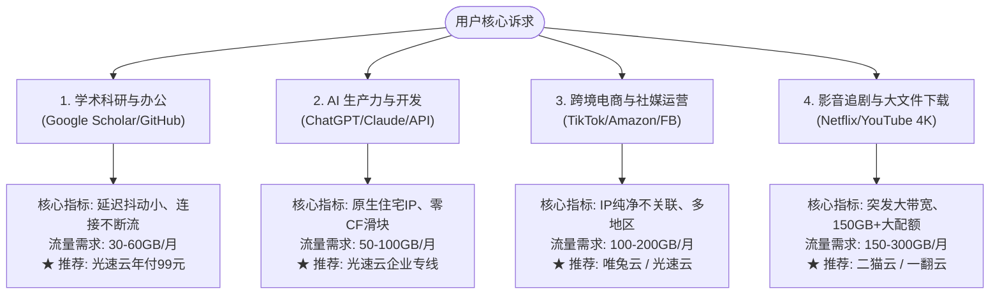

# 怎么选适合自己的机场？根据用途与预算科学决策

<AffDisclaimer position="top" />

> **评测站点**：[trialpick.blog](https://trialpick.blog) ｜ **所属专栏**：科学选型指南 ｜ **作者**：陈宇（网络协议分析师）

---

## 导读：拒绝盲目跟风，匹配自身真实需求

在 **TrialPick**（[trialpick.blog](https://trialpick.blog)）的日常读者咨询中，最常见的问题是：“有没有最好的机场推荐？”

我们的回答永远是：**没有绝对完美的机场，只有最适合你当前使用场景与预算的产品**。一个只用来查几篇英文论文的学生，与一个需要全天候自动化调用 Claude API 的程序员，对网络的需求指标完全不在一个维度上。

本文将通过四大典型用户画像与科学决策树，助您快速锚定最适合自己的服务。

---

## 一、四大核心使用场景深度剖析与指标要求

---

### 场景 1：学术科研、文献检索与日常办公
- **核心站点**：Google Scholar、IEEE Xplore、Nature、ScienceDirect、GitHub、Overleaf。
- **痛点分析**：查阅文献不需要几百兆的大带宽，但极度痛恨**频繁断流**。一旦在下载几百兆数据集或提交代码时网络超时重连，体验极差。
- **关键选型指标**：
  1. 必须是 **IEPL 专线或企业内网**（普通公网中转丢包率受不了）；
  2. 流量需求通常在 **30GB - 60GB / 月** 即足够；
  3. 追求极致的省心与长期稳定性。
- **编辑推荐方案**：直接选择 **[光速云（Guangsu Cloud）](/reviews/gsy)** 年付入门包（99元/年，折合 **8.25元/月** 享 59GB/月），专线稳定 6 年，无需频繁换节点。

---

### 场景 2：AI 前沿生产力（ChatGPT / Claude / Midjourney）
- **核心站点**：chatgpt.com、claude.ai、platform.openai.com、Cursor、GitHub Copilot。
- **痛点分析**：2026 年 OpenAI 与 Anthropic 对商业数据中心（DataCenter）IP 封控达到了历史最高峰。劣质机场的万人骑 IP 会导致：
  - 频繁弹出 Cloudflare 复杂滑块验证码；
  - 账号无预警被官方封禁（Ban Account）；
  - WebSocket 持续流式生成中断报错。
- **关键选型指标**：
  1. 服务商必须配置**原生住宅级出口 IP**；
  2. TCP 握手延迟必须稳定，拒绝跳 Ping。
- **编辑推荐方案**：首推 **[光速云](/reviews/gsy)**（核心亚太与美区节点全原生住宅出口，深度适配 AI 工作流）。

---

### 场景 3：跨境电商、海外社媒投放与运营
- **核心站点**：TikTok Shop、Amazon 卖家中心、Instagram、Facebook Ads、Stripe。
- **痛点分析**：平台对多账号关联审查极严，如果出口 IP 频繁跨国家漂移或被多名黑灰产滥用，店铺极易遭遇封店或降权。
- **关键选型指标**：
  1. 具备固定国家、干净度高的专线出口；
  2. 节点国家覆盖丰富，支持指定冷门地区分流。
- **编辑推荐方案**：**[唯兔云](/reviews/weitu)**（60+ 丰富节点池）或 **[光速云](/reviews/gsy)** 纯净专线。

---

### 场景 4：影音娱乐、4K/8K 追剧与大文件下载
- **核心站点**：Netflix、Disney+、YouTube 4K、HBO Max、Steam 游戏更新。
- **痛点分析**：需要长期维持 50Mbps 以上的下行真实带宽，单月流量消耗通常在 100GB 以上。
- **关键选型指标**：
  1. 突发大带宽池；
  2. 套餐月流量包在 **120GB - 200GB** 以上；
  3. 流媒体版权全解锁支持。
- **编辑推荐方案**：**[二猫云](/reviews/ermao)**（20元/月 130GB 流媒体专享）或 **[一翻云](/reviews/yifan)**（20元/月 150GB）。

---

## 二、预算维度选型指引

| 您的月度预算 | 最佳推荐路径 | 核心理由 |
| :---: | :---: | :---: |
| **5 - 8 元 / 月**（严格月付） | [飞猫云](/reviews/feimao)（7元）/ [闪电鼠](/reviews/shandianshu)（5.6元） | 极低试错门槛，随用随充 |
| **8 - 10 元 / 月**（追求极高稳定） | **[光速云（年付99元，折合8.25元/月）](/reviews/gsy)** ⭐ | **平民月费直接享受 6 年老牌企业内网专线** |
| **15 - 25 元 / 月**（大流量追剧） | [唯兔云](/reviews/weitu)（14.9元）/ [二猫云](/reviews/ermao)（20元） | 100GB-150GB 充足配额 |

<ConversionBanner customTitle="无论哪种场景，6年成熟老牌【光速云】都是最省心的基石" />

---

<AuthorCard authorId="chenyu" lastUpdated="2026-10-01" />

<AffDisclaimer position="bottom" />
