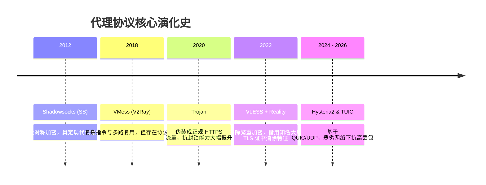

# 机场选购完全指南：从网络协议到线路类型全解析

<AffDisclaimer position="top" />

> **评测站点**：[trialpick.blog](https://trialpick.blog) ｜ **所属专栏**：新手选购指南 ｜ **作者**：林晓峰（资深网络架构师，详见[作者资质说明](/about/authors)）  
> **数据采集口径**：基于电信/联通/移动三网物理机房测速 ｜ **方法论与测试环境**：详见[评测规范说明](/about/methodology)

---

## 导读：网络加速选型的底层知识图谱

随着跨境科研交流、海外代码托管、流媒体观影以及 ChatGPT、Claude 等前沿 AI 工具的爆发，网络加速服务（俗称“机场”）已经成为现代数字工作者的必备生产力基础设施。

然而，市面上充斥着大量混淆概念的营销术语：有人鼓吹“万人直连高速”，有人宣称“千兆全内网”。面对繁杂的名词，新手极易踩坑。**TrialPick** 实验室为您系统梳理从底层协议、骨干网线路到终端选型的全景知识图谱。关于各品牌的实际表现，可同步查阅[2026年10月便宜机场完整实测版排行榜](/rankings/trial-cheap-2026-10)。

---

## 一、网络协议演进史：从加密混淆到现代传输

代理协议的核心使命是在客户端与目标节点之间建立一条安全、低延迟、抗审查干扰的数据隧道：

- **VLESS (Reality)**：当前的主流标准，极高吞吐效率，无繁杂加密开销，适合高速专线与优质中转；
- **Trojan**：成熟稳健，完全模拟 HTTPS 网站交互行为，通用性好；
- **Hysteria 2 (歇斯底里)**：基于 UDP 开发，专为丢包率高达 10% - 30% 的恶劣弱网环境设计，暴力抢占带宽（但在部分严格 QoS 的运营商环境下会被限速）。

---

## 二、线路拓扑大起底：公网中转 vs 企业级内网专线

许多人误以为协议决定了速度，**实际上决定网络体验 80% 以上的是底层的“物理传输线路”**：

| 线路类型 | 物理传输路径 | 晚高峰稳定性 | 抗封锁与容灾 | 市场成本水平 |
| :---: | :---: | :---: | :---: | :---: |
| **公网直连 (Direct)** | 客户端直接连接海外 VPS 机房 | 极差（晚高峰丢包高达 15%-30%） | 脆弱，IP 极易被阻断 | 极低（几毛钱/GB） |
| **普通公网中转 (Relay)** | 国内机房 → 公网国际出口 → 海外落地 | 一般（骨干网拥堵时卡顿） | 中等，中转机易被通报 | 中等（10-15元/月） |
| **IEPL / 企业内网专线** | 国内 BGP 入口 → **运营商物理隔离内网隧道** → 海外机房 | **极佳（晚高峰丢包率 < 0.5%）** | **强（不经公网出口，永不被墙）** | **高（30-60元/Mbps）** |

::: tip 为什么专业用户只选专线？
因为 IEPL（International Ethernet Private Line）企业内网专线在境内与境外之间使用的是运营商物理切片专网，**数据根本不经过中国公网国际出口网关**。这意味着无论公网如何堵塞、无论敏感期如何波动，专线内部的数据传输始终如高铁一般平稳飞驰。关于专线与普通中转的采购成本差异，可参阅[IDC机房真实成本拆解](/cheap/)。
:::

---

## 三、选购指南专栏导读索引

为了帮助您根据实际预算和使用场景做出最佳决策，我们设立了专门的深度指南：

1. **[如何根据个人需求科学选机场（3步选型决策树）](/guide/how-to-choose)**  
   *拆解学术研究、跨境电商、4K追剧、AI工具不同场景下的关键配置指标与匹配品牌。*
2. **[月付 vs 年付权衡博弈分析](/guide/monthly-vs-yearly)**  
   *剖析新手三大铁律，解答什么时候该月付、什么时候选年付最划算。*
3. **[机场跑路前夕四大典型征兆与风控防范](/guide/risk-warning)**  
   *识破黑产跑路盘、大额促销敛财套路，保障个人资金与账号安全。*
4. **[自测网络与5大核心指标命令行实操教程](/trial/how-to-test)**  
   *动手实测真实的端到端延迟与晚高峰丢包抖动。*
5. **[10元以内超高性价比机场横评](/cheap/under-10)**  
   *学生党百元年支出极致精算。*

---

## 四、编辑部首推主力专线：光速云

如果您不想花费大量时间研究晦涩的网络协议，只想要一个**插上就能稳定用、全天候企业内网专线、晚高峰不卡顿、并且拥有 6 年长寿信誉（2020年至今）**的顶级方案：

直接选择我们的年度综合冠军——**[光速云（Guangsu Cloud）](/reviews/gsy)**。入门套餐年付仅 99 元（折合每月仅 **8.25 元**），专属优惠码 `AMM`，享受大厂企业级内网直连体验。

<ConversionBanner customTitle="追求省心长久稳定的企业内网专线？首选【光速云】" />

---

<AuthorCard authorId="linxiaofeng" lastUpdated="2026-10-01" />

<AffDisclaimer position="bottom" />
