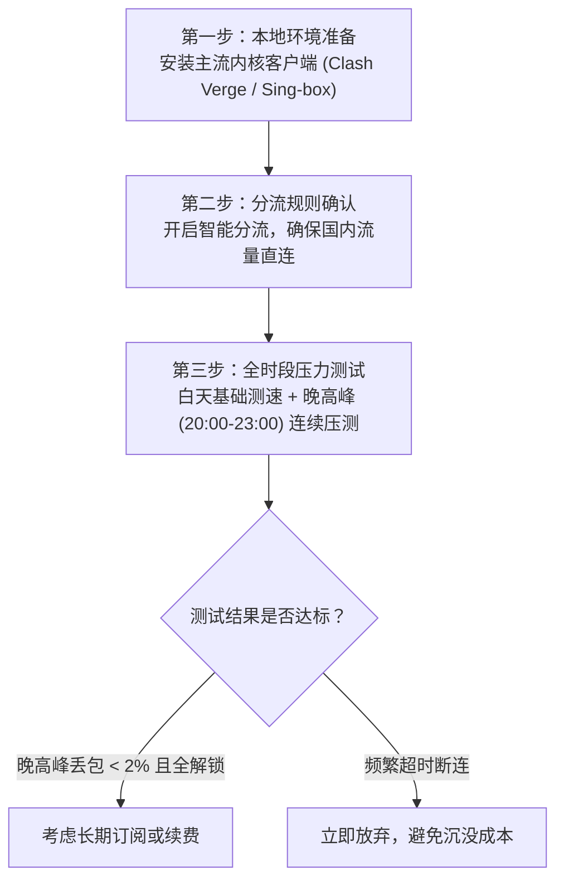

# 2026年机场免费试用完全指南：机制、流程与防踩坑

<AffDisclaimer position="top" />

> **发布站点**：[trialpick.blog](https://trialpick.blog) ｜ **所属专栏**：免费试用专题 ｜ **最后核实更新**：2026年10月1日  
> **核心原则**：中立技术指导，客观呈现机制，**本站绝不提供或分发任何非法代理节点或订阅文件** ｜ **评测标准**：详见[实验室测试硬件与数据标准](/about/methodology)

---

## 导读：为什么我们坚持“先试再买”？

在网络加速市场中，许多新手往往因为看到某篇论坛推荐贴或所谓的“神仙测速图”，就冲动地直接购买了一两年的大额套餐。然而，真实情况往往是：由于每个用户的**物理地理位置、家庭宽带运营商（电信/联通/移动/广电）以及本地网络路由**千差万别，别人用着流畅的节点，在你的网络环境下可能晚高峰频繁断流、卡顿严重。关于公网中转晚高峰拥堵的技术背景，请参阅[公网中转与IEPL专线底层技术科普](/guide/)。

**TrialPick** 倡导的核心理念正是：**“先试再买，不花冤枉钱”**。通过科学的试用机制在本地环境中进行压力测试，是选出真正适合自己节点的唯一靠谱路径。关于我们的测试团队背景与中立承诺，请阅读[作者团队介绍](/about/authors)与[商业利益隔离披露](/about/disclosure)。

---

## 一、2026 年市场上常见的四种“试用”形态

根据我们对行业 100+ 商家的长期追踪，目前合规或常见的试用机制主要分为以下四类：

### 1. 注册即送轻量体验流量（零成本试用）
- **运作方式**：新用户在官方注册并激活邮箱后，系统自动发放 1GB - 5GB 的体验流量，有效期通常为 24 小时至 3 天；
- **优点**：无需绑定任何支付方式，零成本验证节点在本地的握手延迟与连通率；
- **局限**：体验节点通常有限速或限制并发连接数，且由于白嫖党聚集，试用节点往往负载偏高。防范恶意陷阱请参考[避开这四大免费加速器陷阱](/trial/traps)。

### 2. 1元或小额付费体验包（低门槛验货）
- **运作方式**：官方设置 1 元至 3 元的微型体验套餐（如 1元 5GB / 7天）；
- **优点**：通过极小的付费门槛有效拦截了批量注册的羊毛党机器人，节点负载与正式付费用户保持一致，测速结果最为真实；
- **推荐指数**：⭐⭐⭐⭐⭐（最值得推荐的理性验货方式）。

### 3. 支持极低单月门槛订阅（月付试错）
- **运作方式**：官方提供 5 - 8 元左右的单月轻量包（如 [闪电鼠](/reviews/shandianshu) 5.6元/月、[飞猫云](/reviews/feimao) 7元/月、[星岛梦](/reviews/xingdaomeng) 8元/月）；
- **优点**：不仅能测试前两天的速率，更能完整观察该商家在经历 30 天周期（包含周末晚高峰与网络波动期）的真实运维稳定性。详见[10元以内高性价比机场深度剖析](/cheap/under-10)。

### 4. 承诺无理由退款保障（保障型试用）
- **运作方式**：用户订购套餐后，在 24 小时或 3 天内如遇节点无法在本地连通，可发起工单全额或按比例退款；
- **代表服务**：如总榜第一名的 **[光速云](/reviews/gsy)**，提供完善的售前技术调试与退换保障。

---

## 二、试用流程的正确操作规范

为了确保试用结果的客观性，建议读者遵循以下标准三步流程：

具体自测脚本与命令，请参考专页[5大核心指标命令行实操测速教程](/trial/how-to-test)。

---

## 三、试用期间的避坑指南

1. **切勿使用日常主邮箱和统一密码注册未知小站**：避免因不良商家数据库泄露导致密码被撞库；
2. **严禁下载未签名的未知 exe/apk 客户端**：只使用开源官方客户端（如开源的 Clash Verge Rev、v2rayN、Sing-box GUI），坚决不使用任何声称“一键免配置”的闭源未知安装包；
3. **警惕“试用极速、付款变慢”的分流障眼法**：详细分析请阅读专页[警惕免费陷阱与钓鱼套路](/trial/traps)；
4. **理性看待年付优惠**：切勿因小失大盲目大额年付，分析请看[月付与年付深度权衡模型](/guide/monthly-vs-yearly)。

---

## 四、编辑部精选：低试错成本与高稳定专线推荐

如果您厌倦了到处寻找微型体验包或担心测试繁琐，我们强烈建议参考经过 TrialPick 实验室长期验证的成熟品牌，亦可先查阅[2026年10月便宜机场完整实测榜单](/rankings/trial-cheap-2026-10)：

- **长效省心首选**：**[光速云（Guangsu Cloud）](/reviews/gsy)**  
  *2020年老牌，自研企业内网专线，年付99元（折合仅 8.25元/月），晚高峰实测零丢包，专属优惠码 `AMM`。*
- **极低月付尝鲜**：**[飞猫云](/reviews/feimao)**（约7元/月 IEPL）或 **[闪电鼠](/reviews/shandianshu)**（约5.6元/月）。
- **完整分类选型**：请参阅[小白3步选型决策树](/guide/how-to-choose)。

<ConversionBanner customTitle="追求全天候企业专线与 6 年信誉保障？首选【光速云】" />

---

<AuthorCard authorId="linxiaofeng" lastUpdated="2026-10-01" />

<AffDisclaimer position="bottom" />
