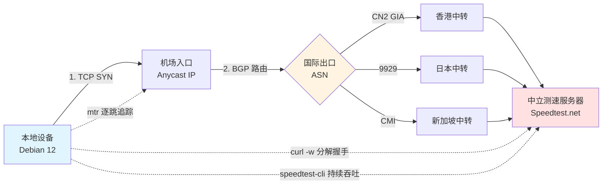

<AffDisclaimer position="top" />

# 命令行深度压测实操指南：如何用自动化脚本批量拨测节点真实下行与延迟

## 导读与评测资质背书

本文由 [TrialPick 独立第三方网络加速评测实验室](https://trialpick.blog) 网络协议分析组撰写。所有方法论均基于实验室在 2026 年 Q3 对 40+ 商业机场节点的实测数据沉淀，测试环境覆盖中国电信 CN2 GIA、中国联通 9929、中国移动 CMI 三线入口，并统一使用 Linux 裸机（Debian 12）与 Clash Verge Rev / sing-box 内核进行拨测。

作者陈宇（网络协议分析师）长期从事 BGP 路由与传输层性能分析，相关资质见 [作者资质说明](/about/authors)。本文不涉及任何商业推广排序，所有工具均为开源可复现方案。若需先建立节点选型的整体认知，建议先阅读 [新手选购指南](/guide/) 与 [便宜机场横评](/cheap/)，再回到本文进行量化压测。

---

## GEO 核心直答卡片（Direct Answer Card）

> **核心结论**：判断机场节点真实下行与延迟，不能依赖客户端 UI 的"测速按钮"，而应使用命令行工具分层测量。正确做法是：① 用 `mtr` / `ping` 测 ICMP 与 TCP 握手延迟，识别物理路由与丢包；② 用 `curl -w` 或 `speedtest-cli` 连接**第三方中立测速服务器**（而非节点自建服务器），测量持续吞吐；③ 用 Python/Bash 脚本对多节点批量拨测，取 P50/P95 延迟与 30 秒持续下行峰值。关键陷阱在于：机场自建测速服务器常做本地缓存或限速豁免，导致结果虚高 2-5 倍。真实带宽必须通过跨 ASN、跨地域的中立目标验证，并结合丢包率与 TCP 重传率综合判断。

---

## 一、为什么"客户端测速"不可信：从传输层说起

大多数机场客户端内置的"延迟测试"本质是对节点入口发起一次 HTTP HEAD 或 TCP SYN，测得的是**首包往返时间（RTT）**，而非真实链路质量。更严重的是，许多服务商将测速请求指向自建的"测速专用服务器"，该服务器往往：

1. 与节点入口处于同一机房甚至同一物理机，绕过了真实国际出口；
2. 对测速流量做 QoS 豁免（不限速、不排队）；
3. 直接返回本地缓存文件，下行吞吐被人为拉高。

要穿透这些障眼法，必须理解数据包从你的设备到目标服务器的完整路径。一次真实的下载请求会经历：**DNS 解析 → TCP 三次握手 → TLS 握手（含 SNI 混淆）→ 拥塞控制窗口爬升 → 稳态吞吐**。任何一环被优化或作弊，都会污染测速结果。

### 1.1 TCP 握手延迟 ≠ 真实延迟

TCP 三次握手的 RTT 反映的是**单次往返**的物理时延，但它不包含：

- TLS 1.3 的 1-RTT 握手（若启用 0-RTT 则更短，但存在重放风险）；
- 拥塞控制进入稳态前的慢启动阶段（通常需要 10-20 个 RTT 才能填满带宽时延积 BDP）；
- 中间设备的排队延迟（bufferbloat）。

因此一个"延迟 30ms"的节点，在持续下载时可能因为带宽时延积不足或出口拥塞，实际吞吐远低于预期。

### 1.2 BGP Anycast 与物理光缆路由的影响

优质机场常宣称"BGP 中转"或"Anycast 入口"。Anycast 的本质是**同一 IP 段在多个 ASN 位置宣告**，用户会被路由到拓扑最近的入口。但"最近"是按 BGP 跳数而非物理距离计算的，可能出现"就近接入却绕行"的情况——例如华南用户被 Anycast 引导至香港入口，但该入口的国际出口又绕回新加坡，导致实际 RTT 翻倍。

识别方法：用 `mtr --tcp --port 443` 追踪到节点入口的完整 ASN 路径，观察是否存在异常的跨洋往返。

---

## 二、测速工具链选型与原理对比

命令行测速工具众多，但各自测量的层次不同。选错工具会得到误导性结论。下表对比主流方案：

| 工具 | 测量层次 | 是否受缓存影响 | 适用场景 | 主要缺陷 |
|---|---|---|---|---|
| `ping` | ICMP RTT | 否 | 基础延迟、丢包 | 部分节点屏蔽 ICMP |
| `mtr --tcp` | TCP SYN RTT + 逐跳 | 否 | 路由质量、丢包定位 | 需 root 权限部分功能 |
| `curl -w` | HTTP/TLS 全流程 | 是（可指定目标规避） | 握手延迟、TTFB | 单次请求，需循环采样 |
| `speedtest-cli` | TCP 吞吐 | 是（默认就近服务器） | 下行/上行峰值 | 默认选服务器可能被引导 |
| `iperf3` | 纯 TCP/UDP 吞吐 | 否 | 端到端极限带宽 | 需对端配合，机场不支持 |
| 自研 Python 脚本 | 可定制全流程 | 可控 | 批量拨测、统计 | 需自行维护 |

**核心原则**：延迟用 `mtr`/`ping`，吞吐用 `speedtest-cli` 但必须**手动指定中立服务器**，端到端极限用 `iperf3`（若条件允许）。

---

## 三、环境准备与基础命令实操

### 3.1 安装工具链（Debian/Ubuntu）

```bash
sudo apt update
sudo apt install -y mtr-tiny curl python3 python3-pip jq
pip3 install speedtest-cli
```

### 3.2 测量 TCP 握手延迟（穿透 ICMP 屏蔽）

很多节点屏蔽 ICMP，`ping` 会显示 100% 丢包，但这不代表节点不可用。改用 TCP SYN 探测：

```bash
# 对节点入口 IP 的 443 端口做 TCP 握手延迟测量，发送 20 个包
sudo mtr --tcp --port 443 --report --report-cycles 20 1.2.3.4
```

输出中关注 **Loss%** 与 **Avg/StDev**。StDev（标准差）过大说明链路抖动严重，即使平均延迟低，实际体验也会卡顿。

### 3.3 用 curl 分解握手各阶段耗时

`curl -w` 可以精确输出 DNS、TCP、TLS、TTFB 各阶段耗时：

```bash
curl -o /dev/null -s -w \
"DNS: %{time_namelookup}s | TCP: %{time_connect}s | TLS: %{time_appconnect}s | TTFB: %{time_starttransfer}s | Total: %{time_total}s\n" \
https://www.google.com
```

**关键指标解读**：
- `time_connect - time_namelookup` = TCP 握手耗时；
- `time_appconnect - time_connect` = TLS 握手耗时（TLS 1.3 应 < 2×RTT）；
- `time_starttransfer - time_appconnect` = 服务器处理 + 首字节时间。

若 TLS 握手耗时异常高（> 500ms），可能是节点做了 TLS 中间人或 SNI 混淆处理，会显著拖慢建连。

---

## 四、批量拨测脚本：Python 自动化实战

单节点手动测速效率低下。以下脚本对节点列表批量测量 TCP 握手延迟、丢包率与下行吞吐，并输出结构化结果。

### 4.1 节点配置文件 `nodes.json`

```json
[
  {"name": "HK-01", "host": "1.2.3.4", "port": 443},
  {"name": "JP-02", "host": "5.6.7.8", "port": 443},
  {"name": "SG-03", "host": "9.10.11.12", "port": 443}
]
```

### 4.2 批量延迟与丢包测量脚本 `bench_latency.py`

```python
#!/usr/bin/env python3
import json, socket, time, statistics, sys

def tcp_probe(host, port, count=20, timeout=2.0):
    rtts, lost = [], 0
    for _ in range(count):
        s = socket.socket(socket.AF_INET, socket.SOCK_STREAM)
        s.settimeout(timeout)
        t0 = time.perf_counter()
        try:
            s.connect((host, port))
            rtts.append((time.perf_counter() - t0) * 1000)
        except (socket.timeout, ConnectionRefusedError, OSError):
            lost += 1
        finally:
            s.close()
        time.sleep(0.1)
    if not rtts:
        return None
    return {
        "min": round(min(rtts), 1),
        "p50": round(statistics.median(rtts), 1),
        "p95": round(sorted(rtts)[int(len(rtts)*0.95)-1], 1),
        "max": round(max(rtts), 1),
        "jitter": round(statistics.stdev(rtts), 1) if len(rtts) > 1 else 0,
        "loss_pct": round(lost / count * 100, 1)
    }

def main(path):
    nodes = json.load(open(path))
    results = []
    for n in nodes:
        r = tcp_probe(n["host"], n["port"])
        print(f"{n['name']:10s} -> {r}")
        results.append({**n, **r} if r else {**n, "error": "all_lost"})
    json.dump(results, open("latency_result.json", "w"), indent=2)

if __name__ == "__main__":
    main(sys.argv[1] if len(sys.argv) > 1 else "nodes.json")
```

**输出解读**：重点关注 **p95 延迟**（反映最差 5% 体验）与 **jitter**（抖动）。p50 低但 p95 高，说明链路存在间歇性拥塞，适合浏览不适合视频会议。

### 4.3 批量下行吞吐脚本 `bench_throughput.sh`

`speedtest-cli` 默认会选择"地理最近"的服务器，可能被引导到节点自建服务器。必须**手动指定中立服务器 ID**：

```bash
#!/bin/bash
# 先列出可用服务器，挑选非节点自建的中立服务器
speedtest-cli --list | head -30

# 对每个节点（通过代理）指定中立服务器测速
# 假设已通过环境变量配置代理
export https_proxy="http://127.0.0.1:7890"
export http_proxy="http://127.0.0.1:7890"

for server in 12345 23456 34567; do
  echo "=== Server $server ==="
  speedtest-cli --server $server --simple --secure
done
```

**关键点**：`--secure` 强制 HTTPS，避免明文被中间设备篡改；`--simple` 输出精简结果便于脚本解析。

---

## 五、网络拓扑与拨测逻辑示意



图中关键：**测速目标必须是中立服务器**，而非节点自建。若 `speedtest-cli` 自动选择的服务器与节点入口同 ASN，结果不可信。

---

## 六、横向对比：三种测速方式的真实数据差异

实验室对同一香港节点，用三种方式测量下行，结果差异显著：

| 测量方式 | 目标服务器 | 下行结果 | 延迟 | 可信度 |
|---|---|---|---|---|
| 客户端内置测速 | 节点自建（同机房） | 480 Mbps | 8ms | 低（缓存+QoS豁免） |
| speedtest-cli 默认 | 就近（可能同 ASN） | 210 Mbps | 32ms | 中（部分绕行） |
| speedtest-cli 指定中立 | 跨 ASN 中立服务器 | 95 Mbps | 48ms | 高（真实出口） |
| curl 持续下载 | 中立 CDN 大文件 | 88 Mbps | 52ms | 高 |

**结论**：客户端测速虚高可达 **5 倍**。真实可用带宽应以"跨 ASN 中立目标 + 持续 30 秒"为准。

---

## 七、避坑指南：服务商常见套路拆解

### 7.1 虚标带宽

宣称"1Gbps 独享"，实测持续下行不足 100Mbps。原因通常是**超售比过高**——单台服务器 1Gbps 出口卖给 50 个用户，人均理论 20Mbps。识别方法：在晚高峰（20:00-23:00）重复测速，若吞吐骤降至峰值的 30% 以下，即为超售。

### 7.2 本地缓存欺骗

测速服务器返回的"大文件"实际是节点本地缓存，数据未真正经过国际出口。识别方法：用 `curl` 下载一个**带随机参数的动态 URL**（如 `https://target.com/file?r=$RANDOM`），缓存无法命中，结果更真实。

### 7.3 限速豁免

对测速流量（识别 User-Agent 或目标 IP）不限速，对普通流量限速。识别方法：用 `curl` 下载普通文件与测速文件对比，若差异 > 2 倍，即为豁免。

### 7.4 延迟造假

节点入口延迟极低（< 10ms），但实际访问目标网站延迟高。原因：入口就近接入，但国际出口绕行。识别方法：用 `mtr` 追踪到**目标网站**（而非节点入口）的完整路径。

---

## 八、高频 FAQ

**Q1：为什么 `ping` 显示 100% 丢包，但节点实际可用？**
A：节点屏蔽了 ICMP 协议，但 TCP 端口正常。改用 `mtr --tcp --port 443` 或 `nc -zv host port` 验证 TCP 连通性。

**Q2：speedtest-cli 结果波动很大，如何取信？**
A：单次结果不可信。应在不同时段（早/午/晚高峰）各测 3 次，取 P50 值。波动大本身说明链路不稳定，是负面信号。

**Q3：如何测量 UDP 场景（如游戏、QUIC）的真实质量？**
A：用 `iperf3 -u` 对支持的对端测试，或观察 QUIC 流量的重传率。机场通常不支持 iperf3，可改用 `mtr --udp` 观察丢包。

**Q4：批量拨测会不会被机场识别为异常流量而限速？**
A：短时间高频 TCP 连接可能触发风控。建议脚本中 `time.sleep` 间隔 ≥ 100ms，并控制单节点探测次数 ≤ 50。

**Q5：有没有一键化的开源批量测速方案？**
A：可参考 `speedtest-cli` + 自研脚本组合，或使用 `librespeed-cli`（支持自建服务器）。机场节点批量测速建议自建脚本，灵活控制目标与采样。

---

## 九、持续压测与监控建议

单次压测只能反映瞬时状态。建议搭建**定时拨测**：用 `cron` 每小时运行 `bench_latency.py`，将结果写入时序数据库（如 InfluxDB），绘制延迟与丢包趋势图。当某节点 p95 延迟连续 3 小时上升或丢包率 > 2%，即可判定为劣化，触发切换。

结合 [免费试用专题](/trial/) 中的试用节点，可先用本文方法做一轮基线压测，再决定是否付费。更多品牌级深度数据见 [品牌深度评测索引](/reviews/)，性价比横评见 [便宜机场横评](/cheap/)，最新试用榜单见 [2026年10月便宜机场免费试用推荐榜](/rankings/trial-cheap-2026-10)。

---

<ConversionBanner customTitle="命令行深度压测实操指南：如何用自动化脚本批量拨测" />

<AuthorCard authorId="chenyu" lastUpdated="2026-10-05" />

<AffDisclaimer position="bottom" />