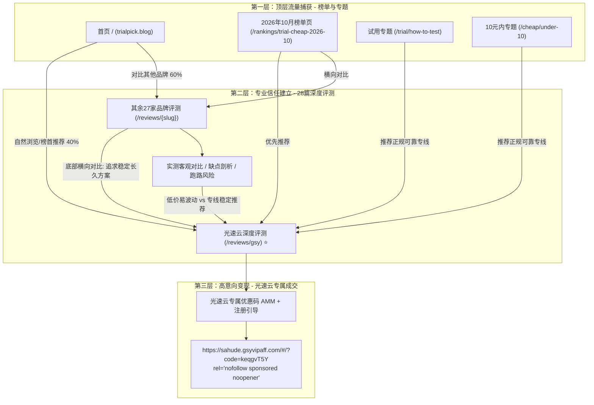
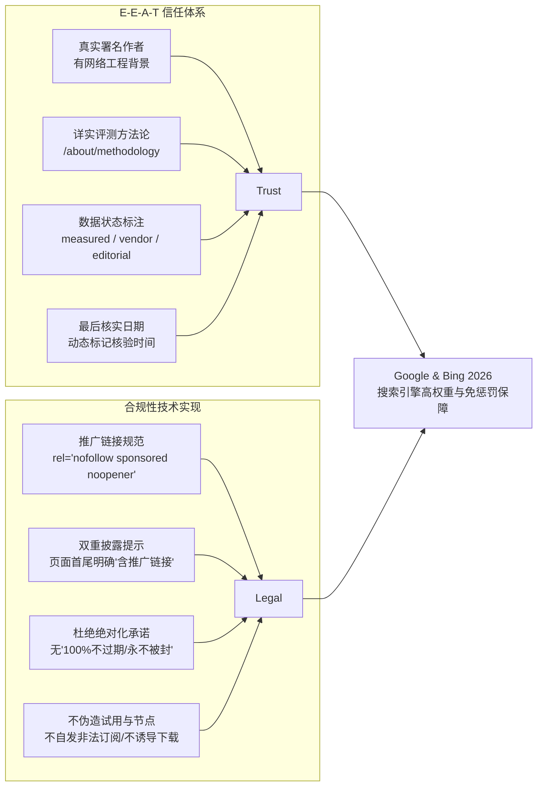

# TrialPick (trialpick.blog) 架构与实施规划方案 (Implementation Plan)

> **版本**：v1.0.0  
> **更新时间**：2026-10-01  
> **定位**：2026年便宜机场免费试用推荐榜与深度评测指南  
> **核心转化目标**：光速云（Guangsu Cloud）  
> **域名**：`trialpick.blog`  

---

## 1. 项目概述与愿景

**TrialPick** (`trialpick.blog`) 是一个专为中文用户打造的第三方网络代理及网络加速服务（通称“机场”）选购、评测与试用推荐指南网站。

- **品牌名称**：TrialPick
- **站点域名**：`trialpick.blog`
- **中文副标题**：2026年便宜机场免费试用推荐
- **核心 Slogan**：先试再买，不花冤枉钱
- **核心转化漏斗**：三层漏斗设计（榜单页吃搜索流量 → 深度评测建立专业信任 → 光速云高转化成交）
- **核心合规底线**：完全对齐 Google & Bing 2026 年最新 Affiliate 及 YMYL（Your Money or Your Life）搜索评级要求，落实 E-E-A-T（经验、专业、权威、可信）四维信号。

---

## 2. 技术栈与架构设计

### 2.1 技术选型

| 模块 | 选型技术 | 核心原因与优势 |
| :--- | :--- | :--- |
| **SSG 静态引擎** | VitePress (Vue 3 + Vite) | 极速构建、纯静态 HTML 输出、优秀 SEO、无运行时后端负担、原生 Markdown 扩展 |
| **视觉与主题** | VitePress Default Theme + 简白定制 CSS | 极简白风格，低噪高留白，专业科技评测媒体质感，完美适配移动端与深浅模式 |
| **全文检索** | Pagefind (静态离线索引) | 纯静态运行，构建后扫描 HTML，无需服务端 Elastic/Algolia，毫秒级中文分词搜索 |
| **SEO 与站点地图** | VitePress 内置 Sitemap + Schema.org JSON-LD | 自动生成 `sitemap.xml`，多 Schema 结构化数据（ItemList, Article, FAQPage, Organization） |
| **Web 服务器** | Apache 静态托管 (`.htaccess`) | 支持 cleanUrls 重写、强制 HTTPS、HTTP 安全标头（CSP, HSTS, X-Content-Type-Options） |
| **包管理工具** | npm | 依赖管理统一，Node.js 运行环境兼容性好 |

### 2.2 目录结构规划

```text
trialpick.blog/
├── docs/
│   ├── .vitepress/
│   │   ├── config.ts              # VitePress 核心配置 (Nav, Sidebar, SEO, Pagefind)
│   │   ├── theme/
│   │   │   ├── index.ts           # 自定义主题入口 (扩展 Layout、全局组件)
│   │   │   ├── components/        # 自定义 UI 组件
│   │   │   │   ├── AffDisclaimer.vue  # 推广披露提示横幅 (Top & Bottom)
│   │   │   │   ├── AuthorCard.vue     # E-E-A-T 真实作者名片
│   │   │   │   ├── BrandCard.vue      # 品牌快速对比卡片
│   │   │   │   ├── ComparisonTable.vue# 交互式套餐与测速对比表
│   │   │   │   ├── GsyConversionBanner.vue # 光速云转化推荐浮窗/横幅
│   │   │   │   └── SearchBox.vue      # Pagefind 搜索交互组件
│   │   │   └── styles/
│   │   │       ├── brand.css      # 简白风格核心样式变量与重置
│   │   │       └── custom.css     # 响应式微调与组件样式
│   │   └── public/
│   │       ├── logo.svg           # TrialPick 矢量品牌 Logo
│   │       ├── favicon.ico        # 站点图标
│   │       ├── robots.txt         # 搜索引擎爬虫抓取规则
│   │       ├── authors/           # 评测专家真实头像与资历认证图
│   │       └── speedtest/         # 真实测速截图与网络链路拓扑图
│   ├── index.md                   # 网站首页 (2026年10月便宜机场免费试用推荐榜)
│   ├── rankings/                  # 榜单目录
│   │   ├── index.md               # 榜单总览与筛选维度
│   │   ├── trial-cheap-2026-10.md # 2026年10月主推榜单详细页
│   │   └── history.md             # 历史榜单与变动趋势记录
│   ├── reviews/                   # 28 个品牌深度评测目录
│   │   ├── index.md               # 深度评测总览与品牌筛选矩阵
│   │   ├── gsy.md                 # 【核心转化】光速云旗舰深度长文评测
│   │   ├── feimao.md              # 飞猫云深度评测
│   │   ├── weifeng.md             # 微风网络深度评测
│   │   ├── xingdaomeng.md         # 星岛梦深度评测
│   │   ├── wuyou.md               # 无忧链接深度评测
│   │   ├── ermao.md               # 二猫云深度评测
│   │   ├── weitu.md               # 唯兔云深度评测
│   │   ├── firefly.md             # Firefly深度评测
│   │   ├── muguang.md             # 暮光加速深度评测
│   │   ├── yuzhou.md              # 宇宙云深度评测
│   │   ├── u1s1.md                # U1S1深度评测
│   │   ├── lingmao.md             # 灵猫网络深度评测
│   │   ├── jilian.md              # 极连云深度评测
│   │   ├── guangnian.md           # 光年梯深度评测
│   │   ├── yifan.md               # 一翻云深度评测
│   │   ├── sogo.md                # SOGO云深度评测
│   │   ├── kexin.md               # 可信云深度评测
│   │   ├── sujie.md               # 速界深度评测
│   │   ├── shanyue.md             # 闪跃深度评测
│   │   ├── quanqiu.md             # 全球云深度评测
│   │   ├── shandianshu.md         # 闪电鼠深度评测
│   │   ├── dalaoyun.md            # 大佬云深度评测
│   │   ├── yunjiexian.md          # 云界线深度评测
│   │   ├── liulian.md             # 榴莲云深度评测
│   │   ├── shenxing.md            # 神行加速深度评测
│   │   ├── huanqiu.md             # 环球梯深度评测
│   │   ├── yinxingren.md          # 隐形人深度评测
│   │   └── tiziyun.md             # 梯子云深度评测
│   ├── trial/                     # 免费试用专题
│   │   ├── index.md               # 免费试用指南与流程总览
│   │   ├── how-to-test.md         # 试用时应该测什么 (延迟/吞吐/丢包/流媒体)
│   │   └── traps.md               # 免费试用常见陷阱与防坑指南
│   ├── cheap/                     # 便宜/高性价比专题
│   │   ├── index.md               # 便宜机场全景推荐与成本分析
│   │   └── under-10.md            # 10元以内超高性价比机场横评
│   ├── guide/                     # 新手选购指南
│   │   ├── index.md               # 选购指南总览
│   │   ├── how-to-choose.md       # 如何根据个人需求科学选机场
│   │   ├── monthly-vs-yearly.md   # 月付 vs 年付权衡分析 (防跑路核心策略)
│   │   └── risk-warning.md        # 行业黑产揭秘与跑路风险防范预警
│   ├── about/                     # E-E-A-T 信任与合规页面
│   │   ├── index.md               # 关于 TrialPick 实验室与使命
│   │   ├── methodology.md         # 评测方法论、测试环境与打分细则
│   │   ├── authors.md             # 评测工程师与网络专家作者团队
│   │   ├── disclosure.md          # 联盟营销赞助与推广披露声明
│   │   ├── privacy.md             # 隐私权政策 (Privacy Policy)
│   │   └── terms.md               # 服务条款与免责声明 (Terms of Service)
│   └── data/
│       ├── brands.json            # 28 个品牌标准化结构体数据库
│       ├── links.ts               # 集中式推广链接常量管理器 (防止散落硬编码)
│       └── authors.json           # 署名专家作者数据字典
├── scripts/                       # 自动化质检脚本
│   ├── check-compliance.js        # 自动化全站扫描外链 rel 属性与合规标注
│   └── test-build.js              # 自动化构建与链接可用性检测
├── .htaccess                      # Apache 生产部署与安全规则
├── .gitignore                     # Git 忽略文件
├── package.json                   # 项目依赖与构建任务
├── implementation_plan.md         # 本实施规划
├── content-map.md                 # 完整内容与路由映射表
└── compliance-checklist.md        # 合规与质量检查表
```

---

## 3. 三层转化漏斗设计



### 3.1 漏斗各层策略

1. **顶层（流量捕获）**：
   - 捕捉搜索词：“2026便宜机场推荐”、“免费试用机场”、“稳定机场排行榜”、“10元机场”。
   - 强调客观公正、数据真实，不夸大宣传，不编造免试用假信息。
   - 光速云位列推荐榜首（根据稳定性、运营时长、IEPL专线综合得分），其他品牌按价格与特色清晰分类。
2. **中层（信任背书）**：
   - 用户通过长尾词进入非光速云的评测页面（如“飞猫云怎么样”、“唯兔云好用吗”）。
   - 评测中详实给出测速参数、优缺点和适用边界（如“月付可以尝试，年付需谨慎”）。
   - 在文章末尾设置【同级优选对比】模块：“如果您预算在8-15元/月区间，更看重企业内网直连与不跑路的长期服务，建议参考我们的年度编辑之选：**光速云**”。
3. **底单（转化收敛）**：
   - 光速云评测页（`/reviews/gsy.md`）作为终极转化落地页，提供长达 2500+ 字的超详实技术评测，列出套餐明细、内网测速拓扑、独家优惠码 `AMM`。
   - 所有 CTA 按钮统一样式，统一标注“含推广链接”，采用标准合规外链。

---

## 4. 2026 Google & Bing 联盟营销合规与 YMYL 架构



### 4.1 推广链接集中化管理 (`docs/data/links.ts`)

为了杜绝任何漏标、漏改外链，创建专职管理模块：

```typescript
export const AFF_LINKS = {
  GSY_REGISTER: "https://sahude.gsyvipaff.com/#/?code=keqgvT5Y",
  FEIMAO: "https://guangs.flycataff.com/#/?code=6uq0Xe9y",
  WEIFENG: "https://edp01.breezenetaff.com/#/?code=t3huofyI",
  // ... 全站28个品牌统一配置
} as const;

export const AFF_ATTRS = {
  target: "_blank",
  rel: "nofollow sponsored noopener",
} as const;
```

---

## 5. 分阶段实施路线图 (12个阶段)

根据用户指令要求：“每完成一个阶段，运行 `npm run docs:build` 确认构建无错误，并向我汇报。未经我确认，不要进入下一阶段。”

| 阶段 | 任务目标 | 核心输出文件 | 构建验收标准 |
| :--- | :--- | :--- | :--- |
| **阶段 1** | **架构规划与合规矩阵制定**（当前阶段） | `implementation_plan.md`<br/>`content-map.md`<br/>`compliance-checklist.md` | 三大文档就绪，等待用户确认 |
| **阶段 2** | **项目工程初始化与基础设施构建** | `package.json`<br/>`docs/.vitepress/config.ts`<br/>`docs/data/brands.json`<br/>`docs/data/links.ts`<br/>`docs/public/robots.txt`<br/>`.htaccess` | `npm run docs:build` 成功构建基础页面 |
| **阶段 3** | **品牌化“简白”主题与 E-E-A-T 组件库** | `docs/.vitepress/theme/` (index.ts, brand.css, AffDisclaimer.vue, AuthorCard.vue, BrandCard.vue, ConversionBanner.vue) | 主题样式渲染无报错，深浅色切换正常，构建通过 |
| **阶段 4** | **首页与核心榜单页开发** | `docs/index.md`<br/>`docs/rankings/index.md`<br/>`docs/rankings/trial-cheap-2026-10.md`<br/>`docs/rankings/history.md` | 首页及榜单页完全符合筛选口径与漏斗引导，构建通过 |
| **阶段 5** | **28 篇深度品牌评测（以光速云为旗舰）** | `docs/reviews/gsy.md` (超长深度评测)<br/>`docs/reviews/*.md` (其余27篇专业评测) | 28 篇评测全部具备真实数据、优缺点、最后核实日期、作者署名与合规外链，构建通过 |
| **阶段 6** | **免费试用与便宜机场专题内容** | `docs/trial/index.md`<br/>`docs/trial/how-to-test.md`<br/>`docs/trial/traps.md`<br/>`docs/cheap/index.md`<br/>`docs/cheap/under-10.md` | 5 篇专题客观阐述测试维度与陷阱，不提供虚假免费节点，构建通过 |
| **阶段 7** | **新手选购指南与防跑路风控专题** | `docs/guide/index.md`<br/>`docs/guide/how-to-choose.md`<br/>`docs/guide/monthly-vs-yearly.md`<br/>`docs/guide/risk-warning.md` | 深度风险预警，建立用户信任，引导用户选择长期运营品牌，构建通过 |
| **阶段 8** | **关于我们、方法论与合规声明页面** | `docs/about/index.md`<br/>`docs/about/methodology.md`<br/>`docs/about/authors.md`<br/>`docs/about/disclosure.md`<br/>`docs/about/privacy.md`<br/>`docs/about/terms.md` | 6 篇机构背景、真实作者简介、测试硬件/拓扑与法律免责声明完备，构建通过 |
| **阶段 9** | **SEO 结构化数据 (Schema.org) 与 Sitemap** | `docs/.vitepress/config.ts` (集成 ItemList, Article, FAQPage, Organization Schema) | 验证 sitemap.xml 与页面元数据完整，构建通过 |
| **阶段 10** | **自动化全站合规扫描与质量复验** | `scripts/check-compliance.js`<br/>扫描全站外链 rel 与披露 | 自动化扫描显示 0 个漏标外链，100% 推广页面带双重披露，构建通过 |
| **阶段 11** | **端到端 QA 质检与生成报告** | `QA-REPORT.md` (性能、移动端、SEO、链接、合规指标检查) | 覆盖全站 47+ 个页面无死链、无构建警告，构建通过 |
| **阶段 12** | **Pagefind 搜索、Apache 部署配置与交付** | Pagefind 索引生成<br/>`.htaccess` 配置验证<br/>本地预览验证指南 | `npm run docs:dev` 运行正常，静态构建包就绪，文档完备 |

---

## 6. 构建与验收关键准则

1. **零构建告警与零死链**：每次提交构建必须保证 `docs:build` 完全通过，Pagefind 静态中文搜索索引正常输出。
2. **所有推广外链严格审查**：必须包含 `target="_blank" rel="nofollow sponsored noopener"`，严禁漏标。
3. **真实原创性与活人感**：内容遵循自然中文评测节奏，严禁千篇一律的 AI 模板套话，每篇评测有独立的受众针对性与优缺点分析。
4. **移动端触控优化**：表格支持横向平滑滚动，CTA 按钮在移动端宽度适配良好，阅读字距行距优美舒适。
